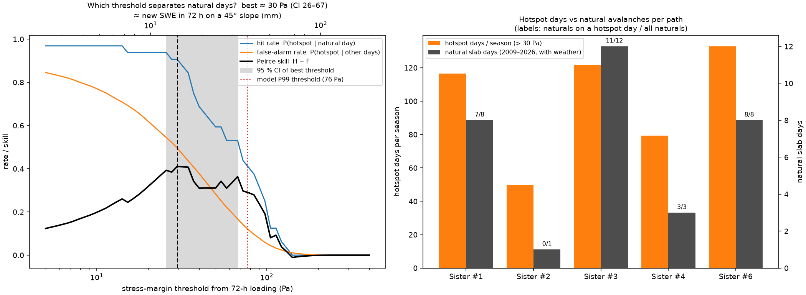
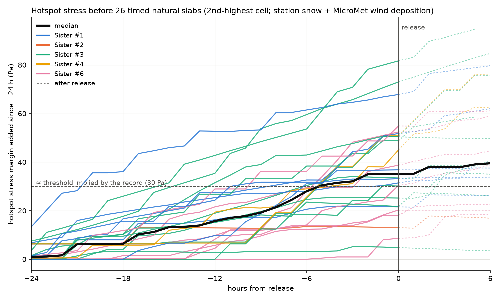
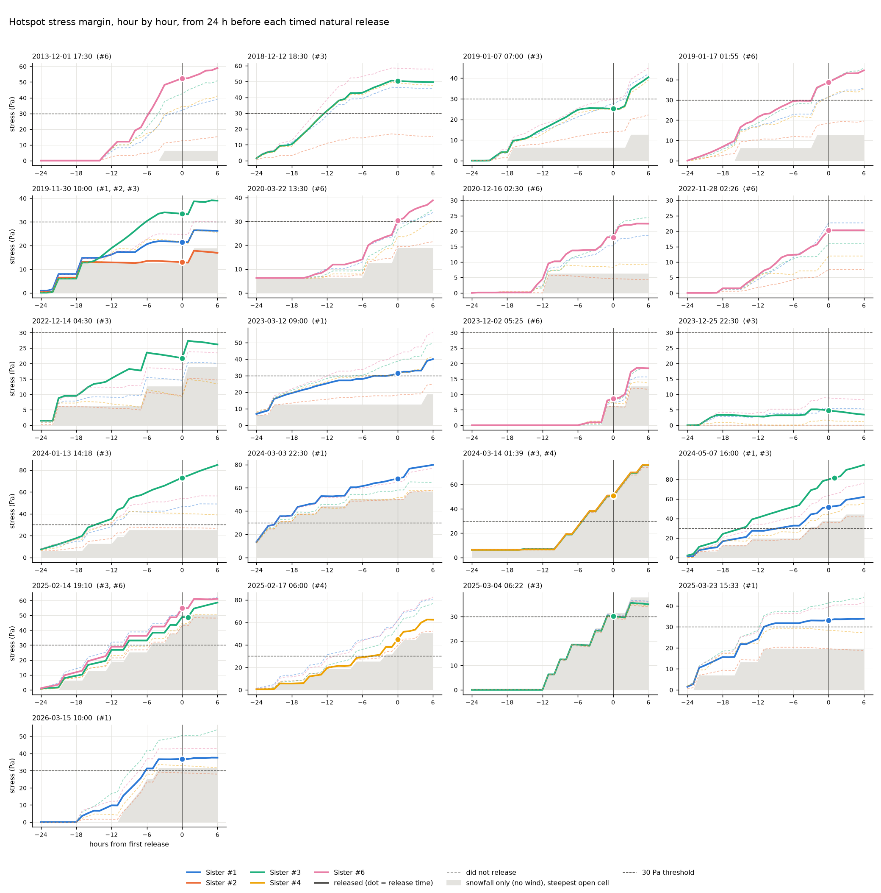

# Natural Slab Release on the Seven Sisters: Threshold, Loading Rate and the Shear Question
### When paths release naturally, and how a natural slab might start — internal research note (November 2026)

This is the second of two notes. The [companion note](terrain_analysis_report.md) covers which paths release and why: data, terrain, the wind-loading and stress model, and the storm-by-storm test. This note uses that model to ask **when** the paths release and what that says about **how** a natural slab starts.

---

## Foreword — do natural slabs start in shear?

Skier-triggered slabs are thought to start as a mixed-mode *anticrack*: a local, fast overload collapses the weak layer and the collapse propagates (Heierli et al. 2008; Gaume et al. 2018). The question behind this note is whether natural slabs can start differently — as a **slow shear failure** under storm loading, in the way laboratory frictional ruptures nucleate (Gvirtzman et al. 2025).

**The proposed sequence.**
1. Where local shear stress passes a weak-layer threshold τ_thresh, a patch starts to fail and grows slowly. The paper puts the time to fast rupture at T ≈ α / (τ − τ_thresh), so it shortens as the excess stress grows.
2. While it is small, the patch is confined and its growth is controlled by the stress threshold. Once it reaches the critical crack length, classical fracture mechanics take over and the crack runs. Confinement therefore matters only in the nucleation phase, not for the whole failure. Fast propagation can still involve weak-layer collapse, and on steep slopes it can become supershear (Trottet et al. 2022). How a slab *starts* and how the crack *propagates* are separate questions.
3. Sintering competes with growth. A weak layer heals while the patch grows, so release needs loading to outpace healing. Rapid loading raises τ − τ_thresh quickly and shortens T. A patch whose edges keep moving also meets fresh, unsintered contacts. Both favour release during fast loading, consistent with the field rule that 30 cm in one day is far worse than 10 cm a day for three days.

**What the Sisters data show — consistent with this picture:**
- Natural releases have a stress threshold (≈ 30 Pa of added shear-stress margin), and the release rate rises with the excess above it (§3.1).
- The last 24 h of loading carry the timing signal; older load adds nothing (§3.3). This fits older load having strengthened by sintering.
- In all 26 releases with a recorded time, loading was still going on, by snowfall or wind transport, mostly within hours of release. In 18 of 26 the modelled hotspot stress was still rising (§3.4). None released after loading had clearly stopped.
- They were cold, dry storm releases (−4 to −19 °C), not warming events.

**What timing alone cannot show.** None of the above tells shear initiation from collapse initiation. On a given cell, shear and normal stress both scale with the same load, so any threshold model — a collapse-driven one included — predicts a threshold, a rate rising with the excess, and release during loading.

**What the normal-stress test adds (§3.5).** The only thing that separates the two is how the load is weighted across slopes: shear stress grows with slope, normal stress shrinks. The model was rerun with normal stress (g·SWE·cos²θ) in place of the shear margin, everything else unchanged.
- **Timing is the same either way** (day AUC 0.75–0.76 at 72 h, 0.83–0.84 at 24 h): *when* a path releases is set by the load, whatever it is weighted by.
- **Picking the path is better with shear.** On natural days, normal stress picks the released path less well (within-day AUC 0.66 vs 0.74, bootstrap p ≈ 0.02–0.06), and its zone pattern fits worse (ρ 0.56 vs 0.82; it expects 3.5 naturals on Sister #2, which had 1). Shear stress without friction does as well as the shear margin, so it is the shear weighting, not the friction angle, that matters.
- So the data favour **shear stress, not normal load, as what decides where a natural releases**. That is consistent with shear-driven nucleation, but it doesn't prove it: shear also drives the slab to slide once the weak layer has failed, however the failure began. The effect is modest and rests on 32 natural days.

**Tests that could tell the two apart further:**
- **Excess stress vs time to release.** Slow shear nucleation predicts that larger excess stress shortens the delay to release. This needs more releases with accurate times.
- **Field observation.** Bed-surface and crown geometry of naturals vs skier-triggered slabs, or seismic and acoustic monitoring for slow precursors in a start zone.

---

## Summary

- **The record implies a stress threshold, and the release rate grows with the excess above it — the paper's pattern.** The threshold that best separates natural days is ≈ 30 Pa of added stress margin from 72-h loading (95 % CI 26–67 Pa; ≈ 14 mm SWE of new load on a 45° slope). 29 of 32 naturals occurred on a day their path had a hotspot above it, and per-path hotspot days rank like natural counts (ρ = 0.82). Naturals are ~20× more frequent at > 80 Pa than below 30 Pa (+20 % odds per 10 Pa). Exceeding the threshold is close to necessary but far from sufficient (only 0.2–0.6 % of hotspot days release) — weak-layer state, not in the model, is the likely missing factor.
- **The last 24 hours of loading carry the timing signal.** Stress from the release day's load predicts natural days better (AUC 0.83; 0.86 with known-date events) than the 72-h load (0.76), and once it is known the earlier 48 h add nothing. At equal 72-h stress, loading concentrated in one day looks ≈ 3× worse than spread loading, but that is not significant (p = 0.2).
- **Timed releases happen during loading.** For the 26 naturals with a recorded release time, modelled hotspot stress rose from a median of 16 Pa at −12 h to 35 Pa at release, still rising in 18 of 26. Wind transport or snowfall was going on before every release (§3.4, anecdotal).
- **Shear stress, not normal stress, picks the path.** Replacing the shear margin with normal stress leaves day prediction unchanged (AUC ≈ 0.75) but worsens path picking (within-day AUC 0.74 → 0.66) and the per-path pattern (ρ 0.82 → 0.56). Consistent with shear-driven nucleation, not proof of it (§3.5).
- **Larger naturals follow higher hotspot stress, weakly.** Median hotspot stress rises from 39 Pa (D1) to 69 Pa (D1.5) and 93 Pa (D2); ρ = 0.32 with D size (p = 0.07), 0.43 (p = 0.015) without one wind-loaded D2.5 outlier.

---

## 1. Framework

**Inspiration.** Gvirtzman, Kammer, Adda-Bedia & Fineberg (2025), *How frictional ruptures and earthquakes nucleate and evolve* (Nature 637, 369–374), show in laboratory friction experiments that rupture nucleation is governed by a **local stress threshold**: a slowly expanding patch starts wherever the local shear stress exceeds τ_thresh, and its time to dynamic rupture shortens as the excess stress grows (T ≈ α / (τ − τ_thresh)), so the nucleation rate scales with τ − τ_thresh. The paper does not discuss snow; the application to slabs is this project's analogy. *(An earlier version of this note mis-cited the paper as a snow-avalanche study; that is corrected here.)*

**Stress margin.** As in the [companion note](terrain_analysis_report.md), the weak-layer stress margin is g·SWE·cos²θ·(tanθ − μ), μ = tan 30°, with load = station snowfall + MicroMet wind deposition and cells near forest excluded. A cell's stress is the margin *added* by recent loading. The **hotspot stress** of a path is its 2nd-highest cell — a patch of ≥ 2 cells, about critical-crack-length scale.

---

## 2. Methods

### 2.1 Stress threshold and avalanche size

A zone has a **hotspot day** at threshold t when its 2nd-highest cell stress margin (72-h load) exceeds t — a patch of ≥ 2 cells, about critical-crack-length scale. Scanning t from 5 to 400 Pa gives the hit rate H = P(hotspot | natural day), the false-alarm rate F = P(hotspot | other days) and the Peirce skill H − F; the threshold maximising it is the record's estimate of τ_thresh, with a season-block bootstrap CI. The stress is the margin *added* by the last 72 h of loading, so the threshold is an increment, not the weak layer's total strength; it is also expressed as the equivalent new SWE on a 45° slope, t / (g·cos²θ·(tanθ − μ)). Release rates are tabulated by hotspot-stress bin, with a logistic trend. Avalanche size (destructive D and relative R) is compared with the release day's hotspot stress, area above the P95 stress threshold, new snow and wind deposition (Spearman, permutation p).

### 2.2 Loading windows

Field experience says rapid loading is far worse than the same load spread over days (30 cm in one day vs 10 cm a day for three days). In the nucleation picture, a patch grows for T ≈ α / (τ − τ_thresh) before dynamic rupture; fast loading raises τ − τ_thresh quickly, shortening T and leaving less time for the weak layer to strengthen by sintering (and an expanding patch keeps exposing fresh, unsintered contacts). The model was rerun with 24- and 48-h loading windows and with the stress from each single day's load (`src/loading_rate.py`).

### 2.3 Hour-by-hour stress before timed releases

26 Sisters natural slabs have a recorded release time, in 21 storms. 9 records are flagged in the CAIC highway export (3 known, 6 estimated). 17 come from the 2020–2026 export, which gives times but leaves the flag empty; many are to the minute and look observed. One estimated-date record at 12:00 AM is a placeholder and was dropped. For each event, the model was rerun hour by hour from 24 h before release to 6 h after (`src/event_stress_timeline.py`). Load is station snowfall (LBAC2, 3-h median) plus MicroMet wind deposition, with the same winds, thresholds and transport as the [companion note](terrain_analysis_report.md) (§4.3). The stress is the 2nd-highest cell in each start zone, as in §2.1. The CALVP and LBAC2 station records around each release were checked as well.

---

## 3. Results

### 3.1 What stress threshold does the record imply?

The model's working threshold (pooled P99 of start-zone stress) is 76 Pa, ≈ 37 mm SWE of new load in 72 h on a 45° slope. Scanning thresholds, the one that best separates natural days is **≈ 30 Pa (95 % CI 26–67 Pa), ≈ 14 mm SWE in 72 h on a 45° slope (12–32 mm)**: hit rate 0.91, false-alarm rate 0.50, Peirce skill 0.41. The skill curve is broad and flat between ~25 and 70 Pa, hence the wide interval.

| Path | Hotspot days / season (> 30 Pa) | Natural days | Naturals on a hotspot day |
|---|---|---|---|
| Sister #6 | 133 | 8 | 8 of 8 |
| Sister #3 | 122 | 12 | 11 of 12 |
| Sister #1 | 117 | 8 | 7 of 8 |
| Sister #4 | 79 | 3 | 3 of 3 |
| Sister #2 | 50 | 1 | 0 of 1 |

- **Exceeding the threshold is close to necessary**: 29 of 32 naturals occurred on a day their path had a hotspot above it, and hotspot days per path rank like the natural counts (ρ = 0.82 for any threshold from 15 to 140 Pa).
- **It is far from sufficient**: at 30 Pa a path has a hotspot on about half of all winter days, and only 0.2–0.6 % of hotspot days produce a natural.

| Hotspot stress | Zone-days | Naturals | per 1,000 zone-days (95 % CI) |
|---|---|---|---|
| < 15 Pa | 4,889 | 2 | 0.4 (0.05–1.5) |
| 15–30 Pa | 3,295 | 1 | 0.3 (0.01–1.7) |
| 30–45 Pa | 2,661 | 9 | 3.4 (1.6–6.4) |
| 45–60 Pa | 1,896 | 3 | 1.6 (0.3–4.6) |
| 60–80 Pa | 1,587 | 4 | 2.5 (0.7–6.5) |
| 80–110 Pa | 1,203 | 9 | 7.5 (3.4–14.2) |
| > 110 Pa | 594 | 4 | 6.7 (1.8–17.2) |

**The release rate shows the pattern of Gvirtzman et al. (2025): an onset at a threshold, then a rate that grows with the excess stress.** Naturals are rare below 30 Pa and about 20 times more frequent above 80 Pa; a logistic trend gives +20 % odds of a natural per additional 10 Pa (95 % CI 12–28 %; zone-days treated as independent, so the interval is optimistic).

Why exceedance is not sufficient: (1) the paper's threshold is location- and state-dependent, while the model uses one fixed value — the presence and strength of a weak layer, not modelled here, is probably the main missing factor; (2) control missions are fired on the most heavily loaded days and remove slabs before they can release naturally; (3) the stress counts only the last 72 h of loading.

**Control missions cannot be treated as simple censoring.** Of the 15 natural zone-days in 2009–2021 (control records end 2021-05-04), 10 fall on a control day or the day after. Crews go out after storms — when natural cycles happen — and that is also when observers are on site to see and log naturals. Removing control days therefore removes most of the naturals too (the remaining 5 all fall on hotspot days, H = 1.0, but that is too few to interpret). This also suggests the natural record is tied to observer presence: naturals between missions are likely logged late, with estimated dates, or not at all.



*Figure 1. Left: hit rate, false-alarm rate and Peirce skill against the stress-margin threshold (72-h loading; top axis: equivalent new SWE on a 45° slope); grey band = 95 % CI of the best threshold. Right: hotspot days per season above 30 Pa and natural slab days per path (labels: naturals on a hotspot day / all naturals).*

### 3.2 Avalanche size

| | Hotspot stress | Area above 44 Pa | 72-h new snow |
|---|---|---|---|
| D1 (n = 8) | 39 Pa | 2 m² | 8 mm |
| D1.5 (n = 17) | 69 Pa | 88 m² | 9 mm |
| D2 (n = 6) | 93 Pa | 248 m² | 21 mm |
| D2.5 (n = 1) | 34 Pa | 0 m² | 0 mm |

*Medians on the release day.*

Larger naturals follow higher hotspot stress and more stressed area, but weakly: Spearman ρ with D size = 0.32 for hotspot stress (permutation p = 0.07), 0.24 for stressed area (p = 0.19) and 0.27 for new snow (p = 0.13); wind deposition alone shows no relation. The single D2.5 event — 2021-01-24 on Sister #6, a hard slab after WSW winds to 28 mph with almost no new snow, from a coordinate-assigned record with an estimated date — is the model's largest miss (34 Pa); without it, ρ = 0.43 for hotspot stress (p = 0.015) and 0.39 for new snow (p = 0.03). That event looks like wind loading the saltation-only model under-represents. Gvirtzman et al. (2025) would predict that nucleation follows local excess stress while size follows the extent of stressed slab; hotspot stress and stressed area are driven by the same loading and are strongly correlated here, so these data cannot separate the two. Size also depends on the path itself (median D1 on Sister #1, D2 on Sister #4), and the size classes are coarse.

### 3.3 Loading rate: does the last 24 h matter?

| Load (2nd-highest-cell stress margin) | AUC, all zone-days (95 % CI) | AUC, known-date events only (26) | Within-day AUC (path picking) |
|---|---|---|---|
| **24-h window (release day)** | **0.83 (0.74–0.90)** | **0.86** | 0.71 |
| 48-h window | 0.81 (0.73–0.87) | 0.82 | 0.69 |
| 72-h window (primary test) | 0.76 (0.68–0.82) | 0.77 | **0.74** |
| Release day alone / day before / two days before | 0.83 / 0.68 / 0.56 | | |

- **The last 24 h carry the signal.** In a logistic model with both, the 24-h stress is strong (p = 0.012; p < 0.001 with known-date events only) and the 72-h stress adds nothing (coefficient ≈ 0, p = 0.5); equivalently, given the release day's load, the preceding 48 h add nothing (p = 0.38). AIC improves by 22 over the 72-h model.
- Every one of the 32 natural days had loading on that path on the release day. On natural days the release-day stress (median 36 Pa) was about as large as the preceding 48 h (35 Pa); on loaded days without a natural it was half as large (19 vs 39 Pa).
- **Path picking still prefers 72 h** (within-day 0.74 vs 0.71): which path releases depends on where wind has deposited over several days; when it releases depends on the last day.
- **Rate at a fixed total is suggestive, not established.** At equal 72-h stress, the odds of a natural are ≈ 3× higher when all of the 3-day load came in one day than when it was evenly spread (logistic, 95 % CI includes 1, p = 0.20; for snowfall concentration alone p = 0.05). Only 432 loaded zone-days had ≥ 80 % of their load in one day, with 3 naturals (9 per 1,000 at 30–60 Pa vs 2–2.4 for spread or mixed loading).

Caveats: the release day's load includes any hours after the release; daily resolution cannot separate *fast* from *recent* loading; and naturals are logged when observers are out, which is often during or just after storms (§3.1). Hour-by-hour stress for the 26 naturals that have a release time is in §3.4.

This supports the reading that recent loading drives natural release and older load does not count — consistent with older load having strengthened (sintering) or relaxed, and with the excess-stress / time-to-failure relation. It does not by itself establish shear-initiated nucleation; a normal-stress-only variant of the stress model would be the next discriminating test.

### 3.4 Hotspot stress before timed releases (anecdotal)

- **Stress builds through the day and fastest near release.** Median hotspot stress was 16 Pa at −12 h, 28 Pa at −6 h and 35 Pa at release, so over half of the 24-h stress came in the last 12 h. 18 of 26 were at or above the 30 Pa threshold of §3.1 at release.
- **Most releases came while stress was still rising.** In 18 of 26, hotspot stress rose by more than 1 Pa in the last 3 h. The 8 flat or slightly falling cases are 2019-01-07, 2019-11-30 (#1, #2 and #3), 2022-12-14, 2023-12-25, 2025-03-23 and 2026-03-15; three of them have estimated times.
- **At the station, loading was going on before every release.** In 22 of 26, wind was above the transport threshold in at least 5 of the 6 hours before release; this is true in 40 % of winter hours. The other four had snowfall in the last 6 h (2023-12-02, and 2024-03-14 on #3 and #4, near-calm with 10 mm SWE in 6 h) or NW transport in 4 of the last 6 h (2023-12-25). Snow had last increased within 6 h of release in 15 of 26. None released after both snowfall and transport had stopped. In all 8 cases where modelled hotspot stress was flat, the station still shows transport; the model deposits it away from the hotspot.
- **Some releases came from wind alone.** 2020-12-16 and 2022-11-28 (#6) and 2023-12-25 (#3) had no new snow at the station in the 24 h before release. These are also the events furthest below the threshold (5–20 Pa). Either the model underestimates wind loading there, or load from before the 24-h window mattered.
- **Cold storm releases.** Temperature at release was −4 to −19 °C. Even the afternoon spring events (2020-03-22 13:30, 2024-05-07 16:00–17:00) were near −9 °C, in snow and wind. Only 2025-03-23 (#1, 15:33, −4 °C) could have had a sun or warming component.
- **Picking the path within a storm is weak hour by hour.** The released path had the highest hotspot stress of the five in 9 of 26 cases (about 5 expected by chance). Wind-loaded storms separate the paths clearly, for example 2013-12-01 (#6) and 2024-01-13 (#3). Snowfall-only storms load all paths almost equally, for example 2024-03-14 and 2025-03-04.
- **The release-day window includes load after the slide.** In 20 of 26 cases snow kept falling later the same day; in 8 the post-release share was larger than the 24 h before release (2024-03-14: 20 mm before, 20 mm after). The release-day AUC in §3.3 is therefore somewhat optimistic.

This is anecdotal. There is no matching set of hourly storms without naturals; release times are converted as MST (UTC−7), so March–May times may be an hour off; snowfall resolves in 2.5 mm steps; and observers on the highway mostly see slides during storm operations, so releases after storms may be under-recorded. Still, the pattern is the one expected if loading has to outpace weak-layer healing: release during active loading, mostly within hours of the last increment.



*Figure 2. Hotspot stress margin (2nd-highest cell; station snow plus MicroMet wind deposition, accumulated from −24 h) for the 26 timed natural slabs, aligned at release. Colour = path; bold = median; dotted = after release; dashed line = 30 Pa threshold.*



*Figure 3. The same per storm, for all five paths. Bold lines with dots: released paths and release times. Faint dashed: paths that did not release. Grey: stress from snowfall alone at the steepest open cell — the gap above it is wind loading.*

### 3.5 Shear or normal stress? (the stress-variant test)

On any one cell, shear stress (g·SWE·sinθ cosθ), the shear margin (g·SWE·cos²θ·(tanθ − μ)) and normal stress (g·SWE·cos²θ) all scale with the same load, so they cannot be told apart from timing. They differ in how they weight slopes: the shear margin is zero at 30° and rises steeply with slope; normal stress is highest on the flattest cells. Which weighting picks the days, the paths and the per-path counts is the one available test of shear- vs collapse-driven release. The wind model was rerun with `--stress` set to each variant; snowfall, wind deposition, forest buffer, the 60° cap and the method for P99 thresholds (from each variant's own distribution) are unchanged (`src/stress_variant_test.py`).

| Stress per unit load | Day AUC, 72 h (P99) | Day AUC, 24 h (hotspot) | Within-day AUC, 72 h (P99) | Within-day, 72 h (hotspot) | Per-path ρ (deviance) |
|---|---|---|---|---|---|
| **Shear margin** cos²θ(tanθ − μ) | **0.76** (0.68–0.82) | 0.83 | **0.74** (0.64–0.83) | **0.74** | **0.82** (2.8) |
| Shear stress sinθ cosθ | 0.75 | 0.84 | 0.73 | 0.75 | 0.82 (2.2) |
| Normal stress cos²θ, slopes > 30° | 0.75 | 0.84 | 0.66 (0.53–0.77) | 0.67 | 0.56 (4.2) |
| Normal stress cos²θ, all slopes | 0.75 | 0.84 | 0.66 (0.53–0.77) | 0.66 | 0.56 (4.6) |

*Expected natural days per path (#1 / #2 / #3 / #4 / #6; observed 8 / 1 / 12 / 3 / 8): shear margin 6.4 / 1.8 / 9.0 / 4.0 / 10.9; normal stress > 30° 9.2 / 3.4 / 8.1 / 3.0 / 8.3.*

- **Timing doesn't discriminate.** Day AUCs agree within 0.015 at 72 h and 0.01 at 24 h. The normal-stress P99 is slightly but consistently lower at 72 h (paired bootstrap p = 0.005), slightly higher at 24 h (n.s.).
- **Path picking does.** Normal stress drops the within-day AUC by 0.08 (paired bootstrap: p = 0.06 for the zone P99, 0.02–0.04 for the hotspot), and at 24 h by 0.06 (p ≈ 0.13). Pure shear stress matches the shear margin (difference ≤ 0.01).
- **The per-path pattern does too.** Normal stress over-predicts Sister #2 (3.4–3.6 vs 1 observed) and Sister #1, and under-predicts Sister #6; ρ falls from 0.82 to 0.56 and the Poisson deviance rises from 2.8 to 4.2–4.6.
- **Head to head.** The two predictors correlate at r = 0.99 across zone-days. With both in a logistic model of the 72-h zone P99, the shear margin keeps a positive coefficient (p < 0.001) and normal stress takes a negative one (p ≤ 0.001): what carries the signal is the *difference* between them — load on steeper cells. For the hotspot cell and for the 24-h window the two can't be separated (p > 0.3).

**Reading.** The data favour shear stress as what decides **where** a natural slab releases; they say nothing about **when** beyond the load itself. Even restricting normal stress to slopes > 30° — the slopes where a slab can slide — leaves it worse, so the result is not just "slabs need steep ground". This is what shear-driven nucleation predicts. It is not proof of it: once a weak layer fails by collapse, shear stress still drives the slab to slide, so a steeper-weighted predictor would also favour collapse-started slabs that only release where the slope can carry them. The differences are modest (bootstrap p 0.02–0.06 for path picking, on 32 natural days), and four variants and several metrics were compared.

---

## 4. Limitations

- **Same model, same caveats.** Loading comes from the wind model and stress model of the [companion note](terrain_analysis_report.md), with its limitations: modelled, not measured, loading; saltation only; one snow station; SNOTEL SWE in 2.5 mm steps.
- **The threshold** is an increment from 72-h loading, assumes one value for all zones and days, and has a wide interval (§3.1).
- **Weak-layer state is not modelled.** This is the most likely reason exceeding the stress threshold rarely produces a natural (§3.1).
- **Observation timing.** Two-thirds of 2009–2021 naturals were logged on a control day or the day after; naturals are seen when observers are out, mostly during and just after storms. Many dates are estimated, and only 26 records have a release time.
- **Daily vs hourly.** The 24/48/72-h windows are calendar days and include load after the release (§3.4). Release times are converted as MST, so March–May times may be an hour off.
- **Shear vs collapse.** On a given cell shear and normal stress scale with the same load, so timing can't separate them; only the slope weighting can (§3.5). That test favours shear but can't separate shear-driven initiation from shear-driven sliding after a collapse.

---

## 5. Next steps

1. **Excess stress vs time to release**: slow shear nucleation predicts that a larger excess stress shortens the delay between the start of loading and release. Rebuild the release-day window to end at the release time, and collect more releases with accurate times.
2. **Separate initiation from sliding**: the stress-variant test (§3.5) can't tell shear-driven initiation from shear-driven sliding after a collapse. Repeat it with the slope gate raised (e.g. normal stress only on slopes > 35°) and with patch-scale stress (hotspots at the critical-crack-length scale vs whole-slab driving stress), to see which scale carries the shear signal.
3. **Weak-layer information**: add a snowpack indicator (e.g. persistent weak layer present, from CAIC observations or a snowpack model such as SNOWPACK driven by CALVP/LBAC2) to the threshold analysis — the step most likely to turn "threshold exceeded" into "release likely".
4. **Observation timing**: two-thirds of naturals were logged on a control day or the day after, so the record is tied to when crews are out. A CDOT mission log (including missions without results, and after 2021) would let control be modelled properly — as both a slab-removal and an observation process — instead of as simple censoring (§3.1).
5. **Field observation**: bed-surface and crown geometry of naturals vs skier-triggered slabs; seismic or acoustic monitoring for slow precursors in a start zone such as Sister #1's west wall.

---

## Appendix — reproducing

Run the wind model and storm test first (see the [companion note](terrain_analysis_report.md), Appendix B), then:

```bash
python src/threshold_analysis.py --site sisters                   # stress threshold, release rate, size (§3.1–3.2)
python src/loading_rate.py --site sisters                         # 24/48/72-h windows, loading rate (§3.3)
python src/event_stress_timeline.py --site sisters                # hourly stress before timed releases (§3.4)
for v in normal normal30 shear; do                                # stress variants (§3.5), ~7 min each
    python src/micromet_loading.py --site sisters --stress $v --tag _st_$v
done
python src/stress_variant_test.py --site sisters                  # shear vs normal stress (§3.5)
```

## References

- Colorado Avalanche Information Center (CAIC) highway observer database, 2009–2021, and CAIC avalanche records export, 2026.
- Gaume, J., Gast, T., Teran, J., van Herwijnen, A. & Jiang, C. (2018). Dynamic anticrack propagation in snow. *Nature Communications* 9, 3047.
- Gvirtzman, S., Kammer, D. S., Adda-Bedia, M. & Fineberg, J. (2025). How frictional ruptures and earthquakes nucleate and evolve. *Nature* 637, 369–374. https://doi.org/10.1038/s41586-024-08287-y
- Heierli, J., Gumbsch, P. & Zaiser, M. (2008). Anticrack nucleation as triggering mechanism for snow slab avalanches. *Science* 321, 240–243.
- Trottet, B., Simenhois, R., Bobillier, G., Bergfeld, B., van Herwijnen, A., Jiang, C. & Gaume, J. (2022). Transition from sub-Rayleigh anticrack to supershear crack propagation in snow avalanches. *Nature Physics* 18, 1094–1098.
