# Terrain-Based Prediction of Natural Avalanche Frequency in Highway Start Zones
### Seven Sisters and Star Mountain Preliminary Results

---

## 1. Motivation

Natural slab avalanches on mountain highway corridors represent a persistent hazard to road users and maintenance crews. While all avalanche start zones on a given corridor share the same regional snowpack and storm exposure, some paths release naturally far more often than others. Understanding *why* and how terrain geometry affects the frequency of these avalanches can improve hazard forecasting, prioritization of mitigation works, and the physical interpretation of avalanche climate data.

The central question this work addresses is:

> Given two start zones on the same mountain, both already steep enough to release a slab, what terrain features explain why one releases significantly more often than the other?

The answer is not simply "steeper terrain." All zones studied here are pre-selected avalanche terrain with mean slopes well above the 35° slab-release threshold. What distinguishes high- from low-frequency zones must therefore lie in features that control either snow accumulation (loading) or fracture initiation mechanics, or the spatial coincidence of both.

This work tests three physically motivated hypotheses:

1. **Aspect diversity hypothesis.** Start zones whose steep terrain faces multiple directions accumulate wind slabs from multiple storm tracks, increasing total loading and the probability of natural release.
2. **Stress concentration hypothesis.** Convex terrain rolls concentrate the normal stress at the base of a slab in the same way a notch tip concentrates mode-I stress intensity (K_I) in fracture mechanics. Zones with more extreme convexity should initiate fractures more readily.
3. **Co-occurrence hypothesis.** Neither loading nor steepness alone is sufficient for release; the spatial coincidence of loaded terrain with steep terrain within the same zone amplifies risk.

---

## 2. Study Sites

Both sites are Colorado highway avalanche paths covered by the CAIC highway program. Seven Sisters sits above US-6 on the west side of Loveland Pass (CAIC highway zone *Loveland Pass*, Front Range). Star Mountain is above CO-82 near Twin Lakes (CAIC highway zone *Twin Lakes*). Prevailing storm winds arrive from the W–NW (225–315°) at both sites. The US-550 paths in the San Juan Mountains (Section 10) are a third site still being processed.

Seven Sisters is a N-facing slope directly above US-6. The road crosses the slope below treeline and the start zones sit at or just below treeline, between about 3,420 m and 3,610 m. Sisters #2, #3 and #4 are adjacent gullies separated by forested ribs. Sister #1 is higher and further west, in open talus. Sister #6 sits highest, on the convex ridge shoulder at the east end.

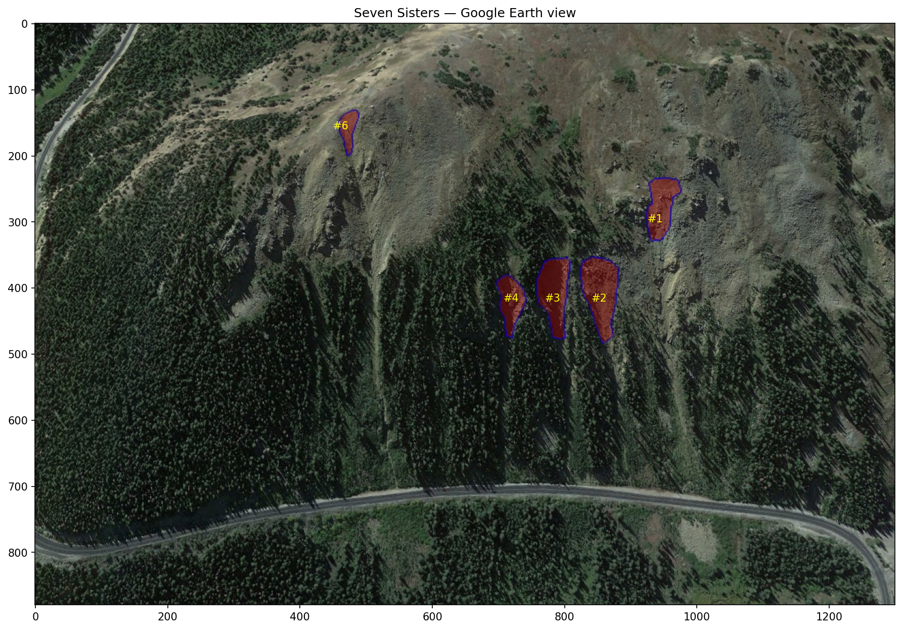

*Figure 1. Seven Sisters start zones (red polygons) on Google Earth imagery. The view looks south (rotated about 180° from north-up), so west is on the right and US-6 crosses the bottom of the frame. Axis units are image pixels.*

| Site | Start zones analysed | Excluded | Record |
|---|---|---|---|
| **Seven Sisters** | #1, #2, #3, #4 | #6 (wind-scoured convex ridge, different regime) | CAIC 2009–2021 |
| **Star Mountain** | C, D, E | A, B (different loading pattern) | CAIC 2009–2021 |

Only natural hard-slab (HS) and soft-slab (SS) avalanches are used. Human-triggered events are excluded to isolate terrain-controlled release. Avalanche frequency is expressed both as raw count and normalised by start-zone area (events per 10,000 m²) to remove the trivial size effect.

---

## 3. Data

### 3.1 LiDAR-derived DEMs

High-resolution DEMs were derived from USGS 3DEP airborne LiDAR:

- **Seven Sisters:** 1.0 m/pixel, NAD83 / UTM zone 13N (EPSG:26913) with NAVD88 heights in metres (EPSG:5703). The source point cloud is in NAD83(2011) / Colorado Central (EPSG:6428) with NAVD88 heights, both in US survey feet. Both are converted to metres during ground extraction.
- **Star Mountain:** 1.0 m/pixel

Processing pipeline (PDAL):

1. Merge raw LAZ tiles
2. Optional spatial crop to site extent
3. Reprojection to a metric CRS (horizontal and vertical), then ground extraction. Seven Sisters uses the vendor's ground classification (class 2). Star Mountain uses SMRF ground segmentation (slope 1.7, window 16 m, threshold 0.45 m) with ELM noise removal and outlier filtering.
4. Ground returns → mean-elevation GeoTIFF. At Seven Sisters, cells with no ground return are filled by inverse-distance weighting from cells up to 3 m away.

At sub-metre resolution, individual convex rolls and slope breaks (the most relevant terrain features to snow loading and slab mechanics) are fully resolved. Coarser 10 m DEMs smooth away these features entirely.

#### Seven Sisters DEM

| Raster | Grid (cols × rows) | Elevation range | Notes |
|---|---|---|---|
| `Sisters.laz` (merged point cloud) | — | 3,250–3,743 m | 6.6 M points over a 0.9 × 1.8 km tile (source CRS, US survey ft) |
| `sisters_crop.laz` (site crop) | — | — | 1.29 M points |
| `Sisters_ground.laz` (vendor ground) | — | 3,278–3,638 m | 681,532 vendor ground points (class 2), UTM 13N / NAVD88 m |
| `Sisters_crp.tif` (site DEM) | 581 × 613 | 3,278–3,638 m | 581 × 613 m; 100 % valid after gap fill |
| `Sisters_SZ_DEM.tif` (all start zones) | 443 × 259 | 3,423–3,621 m | clipped by `Sisters_SZs.kml` |
| `Sister_1_SZ_DEM.tif` | 47 × 64 | 3,498–3,552 m | 1,939 cells = 1,939 m² |
| `Sister_2_SZ_DEM.tif` | 49 × 88 | 3,423–3,495 m | 2,888 m² |
| `Sister_3_SZ_DEM.tif` | 45 × 81 | 3,426–3,497 m | 2,382 m² |
| `Sister_4_SZ_DEM.tif` | 34 × 65 | 3,432–3,489 m | 1,394 m² |
| `Sister_6_SZ_DEM.tif` | 24 × 47 | 3,574–3,611 m | 574 m² (excluded) |

The site DEM descends about 360 m from the ridge to the valley floor below the road, with a mean slope of 29° (Figures 2–4). The slope map shows the four gully systems as parallel steep bands. The highway cut is the low-angle band across the lower third of the DEM. Nearly all terrain above the road faces N to NNE, broken up by W- and E-facing gully walls. About 2 % of cells had no ground return, mostly under dense trees. All were within 3 m of a populated cell and were filled during gridding. None were inside a start zone.

The pipeline's own SMRF filter was tried first. It kept tree crowns in the forested gullies as ground, which left mounds up to about 20 m high in the DEM. In the start zones these covered 9 cells in #1, 55 in #2, 117 in #3 and 100 in #4, raising the surface by up to 4.9 m. The vendor classification has none of these mounds. Switching to it changed the zone statistics by less than 0.5° and left every correlation unchanged except max 1-cell slope (−0.20 → −0.40). It removed about three-quarters of the site-wide nucleation candidates (1,453 → 346 clusters).

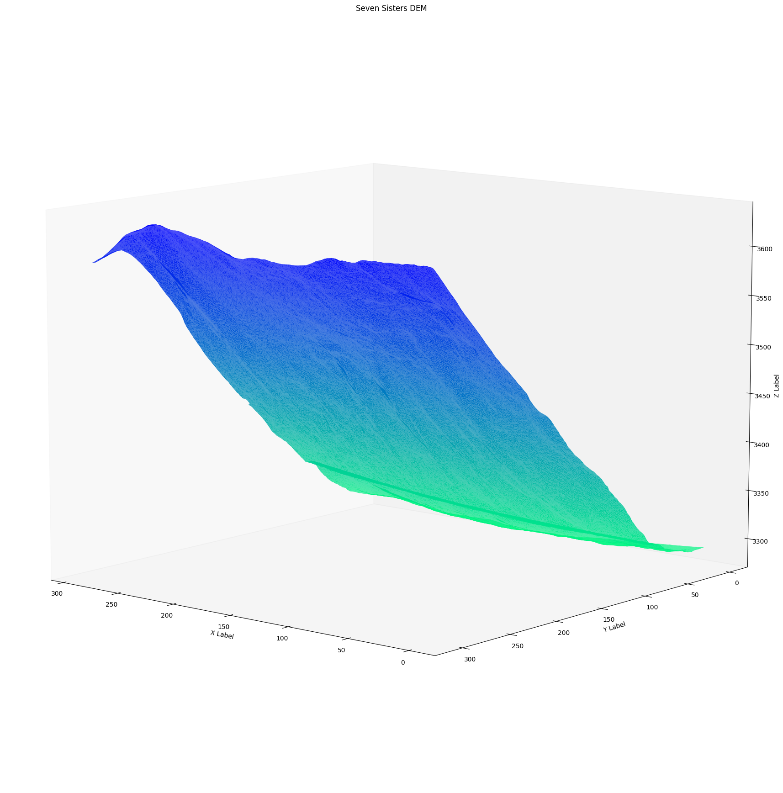

*Figure 2. 3-D view of the Seven Sisters site DEM. The z-axis is elevation in metres. The x and y axes are in pixels of the DEM downsampled by 2 (2 m).*

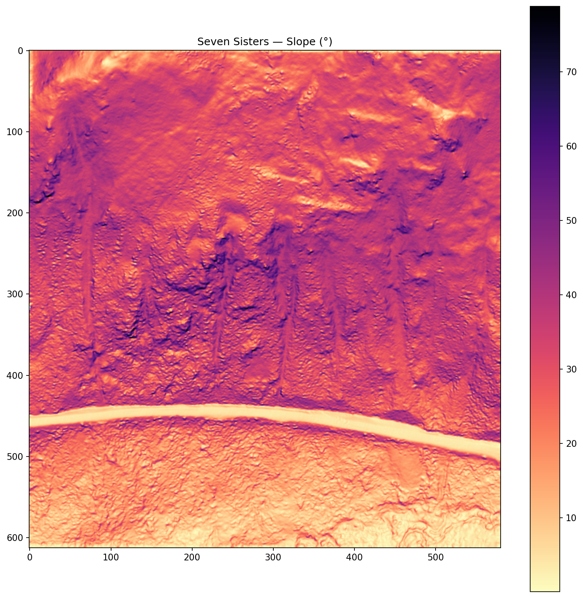

*Figure 3. Slope of the Seven Sisters site DEM in 1 m pixel coordinates, rotated 180° to match Figure 1 (south up).*

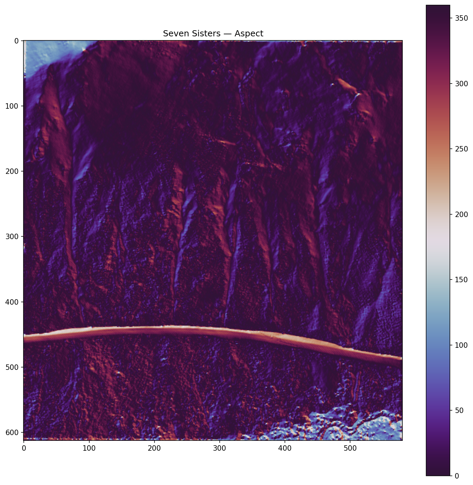

*Figure 4. Aspect of the Seven Sisters site DEM (degrees clockwise from north), oriented as Figure 3.*

### 3.2 Start-zone polygons

Start-zone boundaries were digitised by hand against ortho imagery and stored as KML files. Each zone boundary was clipped from the full-site DEM to produce a per-zone terrain dataset. Terrain attributes (slope, aspect, profile curvature) were computed on the per-zone DEMs using GDAL DEMProcessing and the Evans–Young central-difference formula for profile curvature.

### 3.3 Avalanche records

Colorado Avalanche Information Center (CAIC) highway observer database, 2009–2021. Records were filtered to natural trigger (N) and slab types (HS, SS). Sister #6 records were additionally filtered to above-treeline elevation only to exclude runouts misattributed to the start zone.

---

## 4. Terrain Metrics

All metrics are computed per start zone from the clipped DEM.

| Metric | Description |
|---|---|
| `pct_40_50` | % of cells with slope 40–50° (core slab release band) |
| `slope_max_1cell` | Max slope of any single 1 m² cell — proxy for peak driving stress |
| `aspect_entropy` | Shannon entropy (bits) of aspect over 8 octants, all cells |
| `aspect_entropy_steep` | Same, restricted to cells ≥ 35° — loading diversity of release terrain |
| `pct_steep_near_loading` | % of cells that are steep (≥40°) AND within 2 cells (~2 m) of a W–NW (225–315°) facing cell |
| `profile_curv_p95_steep` | 95th-percentile profile curvature on steep interior cells (boundary pixels excluded) |

Aspect entropy is computed over 8 equally spaced compass octants (0 = unimodal, 3 bits = fully uniform). Shannon entropy is used rather than circular variance because it captures the *number of distinct loading directions*, not just the spread from a mean.

Profile curvature follows the sign convention of Gvirtzman et al. (2025): **positive = convex** (terrain bends away from the viewer looking downslope). Positive curvature concentrates normal stress at the slab base, lowering the energy required to initiate a mode-II crack.

---

## 5. Results — Seven Sisters

> **Re-run with corrected units (October 2026).** An earlier version of this section was computed from a DEM whose elevations were in US survey feet but were processed as metres. That made every slope gradient 3.28 times too steep, and the 1.2 m cell size assumed in the pipeline made zone areas 1.72 times too large. The DEM has since been rebuilt in metres from the vendor-classified ground points (Section 3.1), and all Seven Sisters results below come from that rebuild. The main change is that the fraction of release-angle terrain, which looked negatively correlated with avalanche frequency, is positively correlated.

### 5.1 Avalanche record

| Path | Natural HS/SS (2009–2021) | Events / 10,000 m² |
|---|---|---|
| Sister #1 | 4 | 20.6 |
| Sister #2 | 1 | 3.5 |
| Sister #3 | 5 | 21.0 |
| Sister #4 | 9 | 64.6 |
| Sister #6 | 1 | — (excluded) |

Sister #4 is the most active path by a large margin on a per-area basis (64.6 events / 10,000 m²). Sisters #3 and #1 are nearly tied (21.0 and 20.6), and #2 is the least active.

### 5.2 Terrain metrics

| Zone | Mean slope (°) | Slope SD (°) | % 40–50° | Max slope (°) | Aspect entropy | Aspect entropy (steep) | % steep near loading | Curv P95 steep | Area (m²) |
|---|---|---|---|---|---|---|---|---|---|
| Sister #1 | 37.9 | 6.49 | 34.1 | 62.8 | 0.747 | 0.797 | 0.41 | 0.293 | 1,939 |
| Sister #2 | 39.9 | 5.67 | 46.6 | 69.9 | 0.843 | 0.831 | 0.87 | 0.307 | 2,888 |
| Sister #3 | 44.0 | 6.98 | 56.3 | 68.3 | 1.646 | 1.641 | 33.80 | 0.339 | 2,382 |
| Sister #4 | 44.1 | 7.97 | 48.9 | 66.5 | 1.773 | 1.779 | 18.58 | 0.380 | 1,394 |

Sisters #3 and #4 are about 5° steeper on average than #1 and #2. They also have about twice the aspect entropy, reflecting more complex terrain that faces multiple loading directions. Sister #6, which is excluded from the analysis, has a mean slope of 37.3°.

### 5.3 Slope and aspect distributions

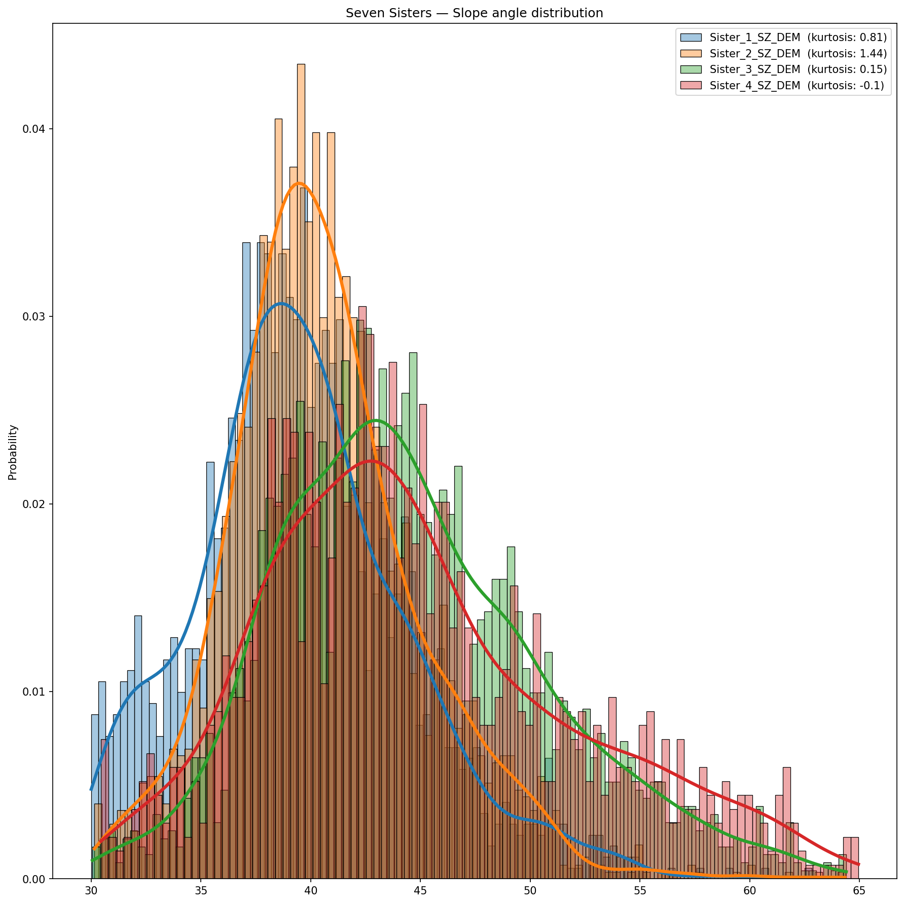

*Figure 5. Slope-angle histograms with KDE for Sisters #1–#4, clipped to 30–65°. Sisters #1 and #2 peak near 39–40° and fall off quickly above 45°. Sisters #3 and #4 peak near 43° with a long tail out to 60–65°.*

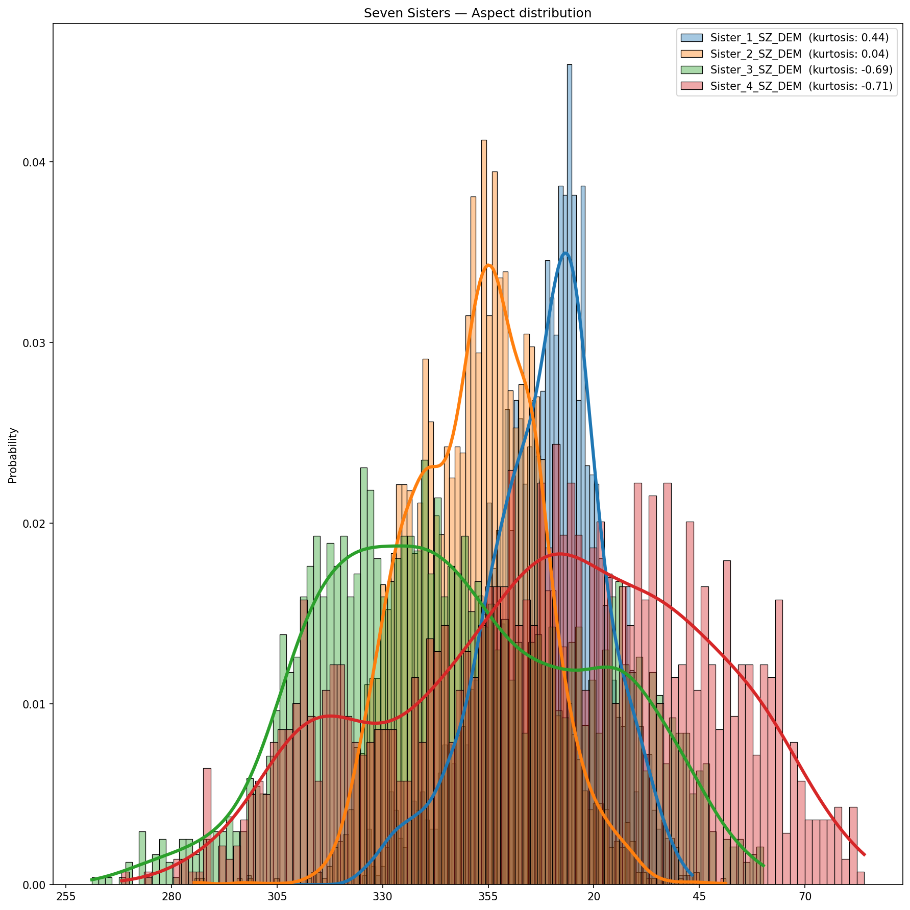

*Figure 6. Aspect histograms with KDE for Sisters #1–#4. Sisters #1 and #2 have narrow, unimodal distributions centred on N–NNE. Sister #3 spreads from W to ENE and peaks at NW (~330°). Sister #4 is bimodal, with a NW mode (~315°) and a broader NNE mode that tails out to E.*

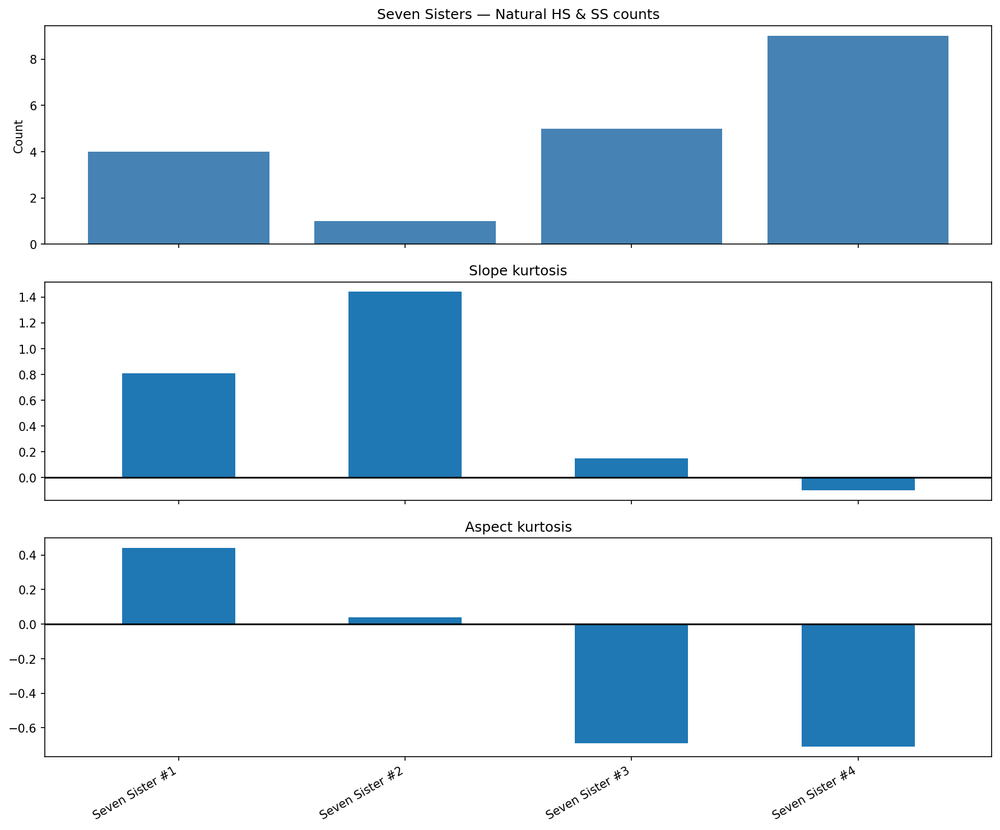

*Figure 7. Natural HS/SS avalanche count (top), slope kurtosis (middle) and aspect kurtosis (bottom) by start zone. Kurtosis is computed on the clipped distributions in Figures 5 and 6. Both slope kurtosis (0.15, −0.10) and aspect kurtosis (−0.69, −0.71) are lowest for #3 and #4. Sister #2, the least active path, has the most peaked slope distribution (1.44).*

Both distributions point the same way: the paths that release most often have broader slope and aspect distributions. This is the variability that the slope SD and aspect entropy metrics measure.

### 5.4 Correlations with avalanche frequency

| Metric | Spearman ρ | Kendall τ |
|---|---|---|
| **Slope SD** | **+1.00** | **+1.00** |
| % 40–50° | +0.60 | +0.33 |
| Max slope 1-cell | −0.40 | −0.33 |
| Aspect entropy | +0.80 | +0.67 |
| Aspect entropy (steep) | +0.80 | +0.67 |
| % steep near loading | +0.60 | +0.33 |
| Profile curv P95 (steep) | +0.80 | +0.67 |

*N = 4, against avalanches per 10,000 m². All p-values are exploratory. With four zones, a perfect rank match occurs by chance with probability 1/24 ≈ 0.04.*

**Slope standard deviation** ranks the four zones in exactly the same order as avalanche frequency. **Aspect entropy** (all cells and steep-only) and **profile curvature P95** come next (ρ = +0.80). The fraction of terrain in the 40–50° band is weakly positive (ρ = +0.60). The earlier ρ = −0.80 was an artefact of the unit error. The steepest single cell is weakly negative (ρ = −0.40). Single-cell maxima pick up small rock steps and DEM noise: Sister #2, the least active path, has the steepest cell (69.9°).

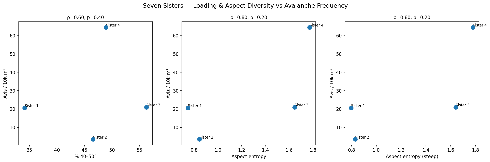

*Figure 8. % 40–50°, aspect entropy, and aspect entropy of steep cells against avalanches per 10,000 m² (Seven Sisters). Each point is one start zone. ρ values are Spearman rank correlations.*

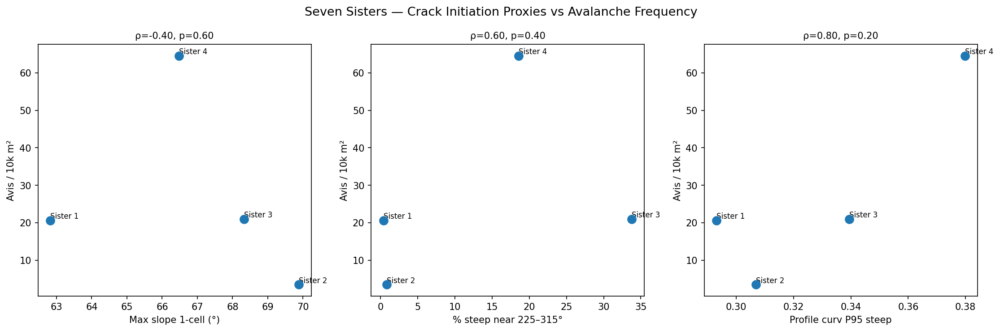

*Figure 9. Max slope 1-cell, loading co-occurrence, and profile curvature P95 against avalanche frequency (Seven Sisters).*

### 5.5 Start-zone slope map

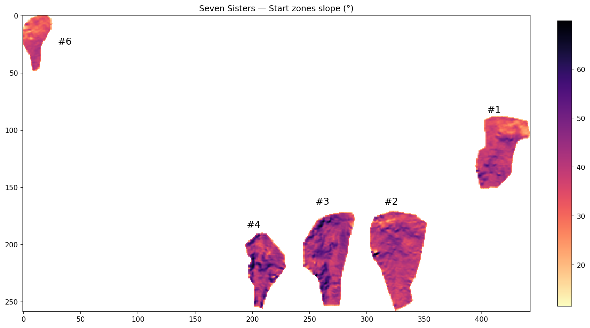

*Figure 10. Slope angle of the combined Seven Sisters start-zone DEM, rotated 180° to match Figure 1 (south up, so #1 is on the right and #6 on the left). Sisters #3 and #4 contain the largest areas steeper than 50° (dark), along their gully walls.*

### 5.6 Nucleation candidate map

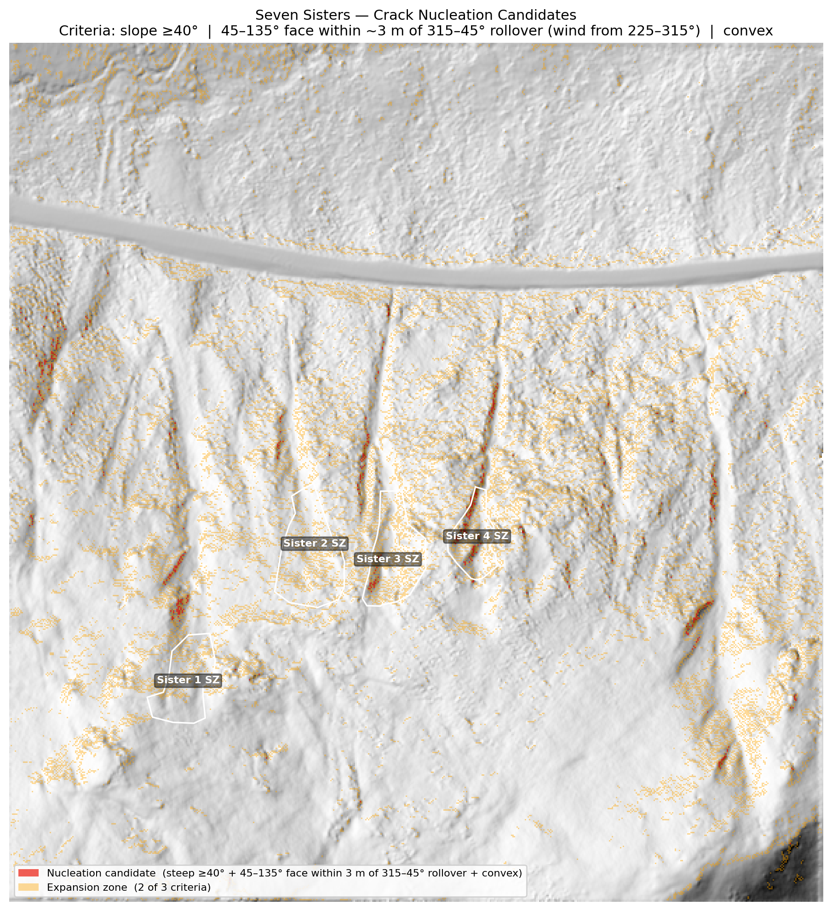

*Figure 11. Likely crack nucleation candidates (red) and expansion-zone candidates (orange) on the Seven Sisters hillshade, north up (US-6 crosses the top). Criteria: slope ≥40°, E-facing terrain within ~3 m of the N→E aspect rollover (wind-deposited lee face), and positive profile curvature. White outlines show start-zone boundaries.*

### 5.7 Nucleation clusters vs. avalanche count

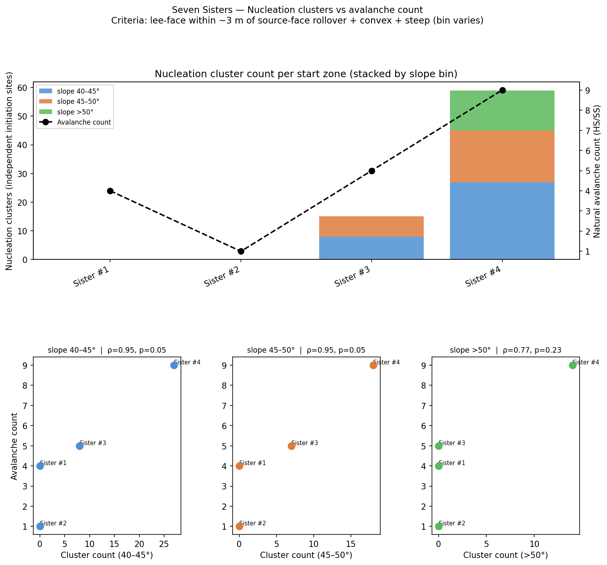

*Figure 12. Number of spatially connected nucleation-candidate clusters per start zone (bars, split by slope bin) against raw natural avalanche count (line). Sister #4 has 59 clusters and #3 has 15. Sisters #1 and #2 have none. Note that Sister One has a relatively high number of avalanches for nucleation points. This can be explained by the nucleation points along the path outside its start zone polygon (Figure 11). In fact, the vast majority of the natural slab avalanches from Sister One originated from this area.*

---

## 6. Results — Star Mountain

### 6.1 Avalanche record

| Path | Natural HS/SS (2009–2021) | Events / 10,000 m² |
|---|---|---|
| Star C | 4 | 0.18 |
| Star D | 9 | 0.83 |
| Star E | 3 | 0.58 |
| Star A | 4 | — (excluded) |
| Star B | 9 | — (excluded) |

Star D is the highest-frequency analysed path. Star A and B are excluded because their different loading pattern (wind-exposed rather than lee-loaded geometry) makes them not directly comparable to C, D, and E.

### 6.2 Terrain metrics

| Zone | % 40–50° | Max slope (°) | Aspect entropy | Aspect entropy (steep) | % steep near loading | Curv P95 steep | Area (m²) |
|---|---|---|---|---|---|---|---|
| Star C | 25.93 | 82.5 | 1.881 | 1.948 | 2.56 | 0.762 | 220,056 |
| Star D | 40.64 | 81.8 | 2.316 | 2.318 | 13.35 | 0.756 | 109,055 |
| Star E | 17.51 | 71.7 | 0.786 | 0.773 | 0.00 | 0.747 | 51,435 |

Star D has the highest aspect entropy (2.32 bits) and the highest proportion of terrain in the 40–50° release band (40.6%), consistent with its status as the most active analysed path.

### 6.3 Correlations with avalanche frequency

| Metric | Spearman ρ | Kendall τ |
|---|---|---|
| % 40–50° | +0.50 | +0.33 |
| Max slope 1-cell | −0.50 | −0.33 |
| Aspect entropy | +0.50 | +0.33 |
| **Aspect entropy (steep)** | **+0.50** | **+0.33** |
| % steep near loading | +0.50 | +0.33 |
| Profile curv P95 (steep) | −0.50 | −0.33 |

*N = 3. All p-values are exploratory.*

With only three comparable zones the correlations are weak and underpowered. The direction of the aspect entropy signal (ρ = +0.50) is consistent with Seven Sisters, but profile curvature shows the opposite sign here (ρ = −0.50). This may reflect that Star Mountain's large, complex start zones are not well characterised by a single curvature percentile.

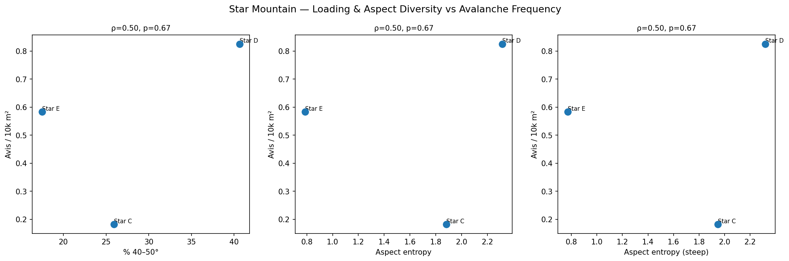

*Figure 13. Terrain predictors vs. avalanche frequency (Star Mountain). N = 3; correlations are exploratory.*

### 6.4 Nucleation candidate map

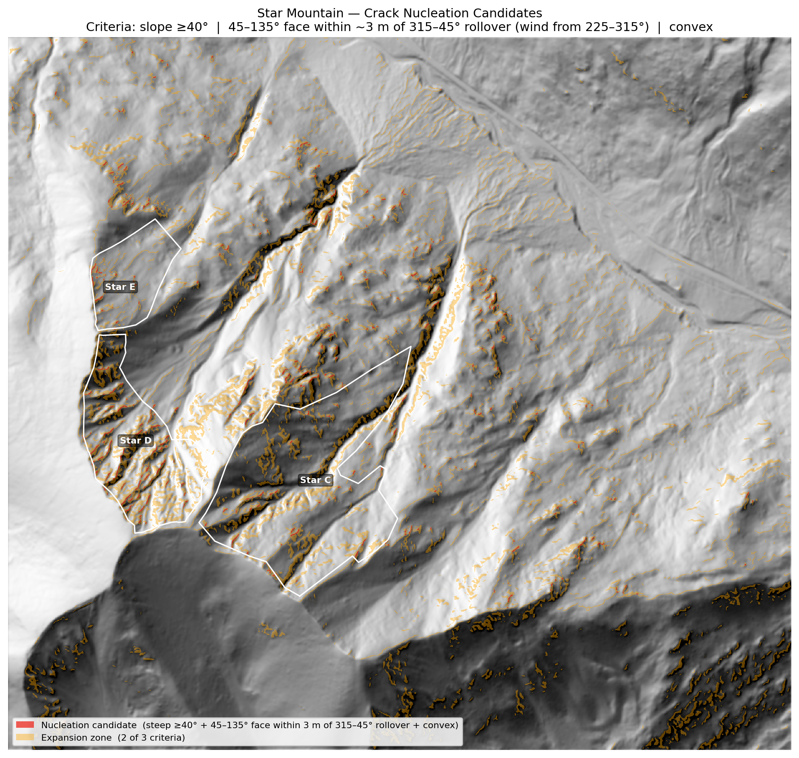

*Figure 14. Nucleation candidates (red) and expansion zones (orange) on the Star Mountain hillshade. The loading geometry is the same W–NW wind source, E-facing lee-slope criterion as Seven Sisters.*

### 6.5 Nucleation clusters vs. avalanche count

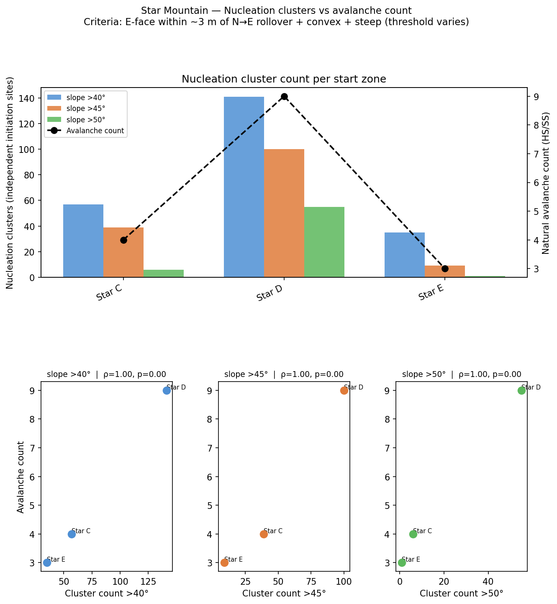

*Figure 15. Nucleation cluster count vs. raw avalanche count (Star Mountain, C/D/E only).*

---

## 7. Cross-site synthesis

Despite the small sample sizes, two patterns are consistent across both sites:

**1. Aspect entropy of steep terrain is the most consistent positive predictor.**  
At Seven Sisters (ρ = +0.80) and Star Mountain (ρ = +0.50), zones with more diverse aspect distributions on their steep terrain have higher avalanche frequency. This is consistent with the wind-loading hypothesis: multi-directional steep faces collect wind slabs from more storm tracks, accumulating heavier and more variable loading conditions.

**2. Raw steepness within the 40–50° band is not a reliable discriminator.**  
% 40–50° is weakly positive at both Seven Sisters (ρ = +0.60) and Star Mountain (ρ = +0.50). At Seven Sisters, the spread of slope angles (slope SD, ρ = +1.00) separates the zones better than the share of terrain in any one band. This is expected: all zones were pre-selected as slab terrain. What matters is not the fraction of release-angle terrain but the geometry that drives loading and fracture initiation.

**3. Profile curvature gives mixed results.**  
The positive signal at Seven Sisters (ρ = +0.80) is physically intuitive — convex rolls concentrate stress — but the signal reverses at Star Mountain (ρ = −0.50). The Star Mountain start zones are an order of magnitude larger than the Sisters zones (50,000–220,000 m² vs. 1,400–2,900 m²), and a single P95 value may not adequately capture the distribution of convexity in such large, complex terrain.

---

## 8. Nucleation site analysis

For each site, likely crack initiation locations were identified by the simultaneous occurrence of three criteria on the full-area DEM:

1. **Slope ≥ 40°:** sufficient driving shear stress
2. **Lee face within ~3 m of the source-face rollover:** wind-deposited slab geometry (Seven Sisters: E-facing terrain within ~3 m of a N-facing ridge cap; Star Mountain: same geometry)
3. **Positive profile curvature:** stress-concentration geometry

Spatially connected patches meeting all three criteria are treated as independent nucleation candidates (Figures 11, 14). The count of these clusters at three slope thresholds (>40°, >45°, >50°) is compared with the observed avalanche count (Figures 12, 15).

At Seven Sisters, Sister #4 has both the largest number of nucleation clusters (59) and the highest avalanche count, followed by #3 (15 clusters). Cluster counts in the 40–45° and 45–50° bins rank-correlate with raw avalanche count at ρ = 0.95. This supports the hypothesis that terrain geometry controls natural release frequency. The exception is Sister #1: it has no clusters inside its polygon but 4 avalanches. Most of its natural slab avalanches start from nucleation points along the path just outside the mapped start zone (Figures 11, 12), so the polygon, not the criterion, misses them. At Star Mountain, the pattern is less clear with only three comparable zones.

---

## 9. Limitations

- **Ground classification differs between sites.** Seven Sisters uses the vendor's ground classification. Star Mountain still uses SMRF, which kept tree crowns as ground at Seven Sisters (Section 3.1). Check Star Mountain for the same problem before comparing the two sites directly.
- **Sample size.** N = 4 (Sisters) and N = 3 (Star Mountain) are too small for meaningful statistical inference. Effect sizes are reported as exploratory. Bootstrap CIs are not computable at these sample sizes.
- **Avalanche record completeness.** The CAIC highway observer record reflects patrol conditions and visibility as well as actual avalanche activity. Small, non-road-impacting events may be systematically under-reported for some paths.
- **Co-occurrence proxy.** Aspect entropy and `pct_steep_near_loading` are computed independently across all cells. A zone can score high on both without the loaded and steep cells coinciding spatially. Definitive co-occurrence analysis requires mapping wind-slab deposition directly onto the terrain.
- **Profile curvature sensitivity.** The P95 metric on interior cells is sensitive to DEM noise at short wavelengths. Results may change with DEM smoothing or alternative curvature estimators.
- **Nucleation criterion geometry.** The N→E rollover criterion was derived from the Seven Sisters geometry. Star Mountain and US-550 may require site-specific aspect ranges for the nucleation analysis to be physically meaningful.

---

## 10. Next steps

1. **Complete the US-550 analysis** (Eagle, Muleshoe, Porcupine, Telescope) to bring the combined N to ~11 across three sites — enough for preliminary cross-site regression.
2. **Weight aspect entropy by prevailing wind frequency** at each site to make the loading proxy more physically grounded.
3. **Map snow depth variability** from repeat LiDAR or GPR onto slope and aspect rasters to directly measure co-occurrence of wind-slab deposition and high-shear-stress terrain.
4. **Refine the nucleation site criterion** using known release locations from observer photos or remote camera data to validate and calibrate the three-criterion mask.
5. **Test profile curvature at multiple spatial scales** — the current 0.9–1 m resolution captures small-scale rolls; smoothed DEMs at 3–5 m may better represent the slab-scale stress geometry.

---

## References

- Gvirtzman, S. et al. (2025). Detection of likely shear initiation location for dry-snow slab avalanches. *Nature*, https://doi.org/10.1038/s41586-024-08287-y
- Pingel, T. J., Clarke, K. C., & McBride, W. A. (2013). An improved simple morphological filter for the terrain classification of airborne LIDAR data. *ISPRS Journal of Photogrammetry and Remote Sensing*, 77, 21–30.
- Colorado Avalanche Information Center (CAIC) highway observer database, 2009–2021.
- USGS 3D Elevation Program (3DEP) LiDAR data.
