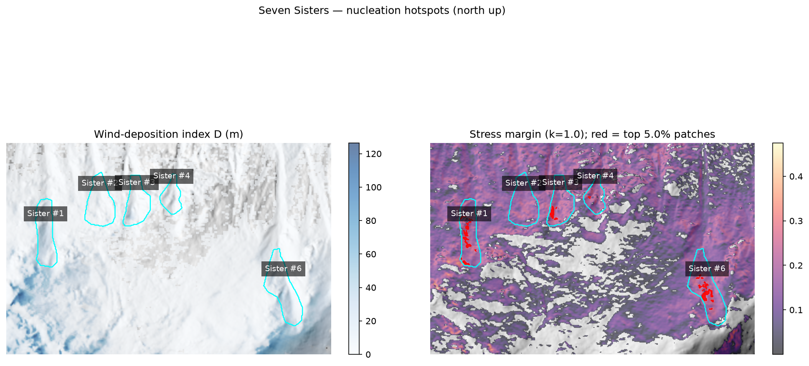
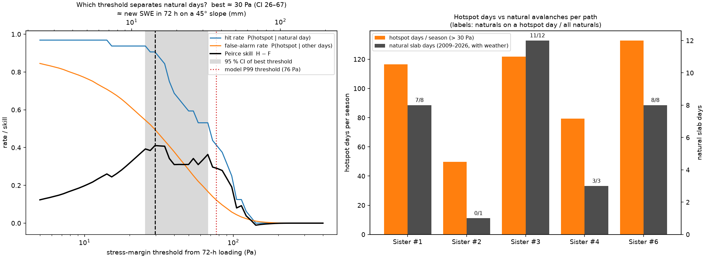
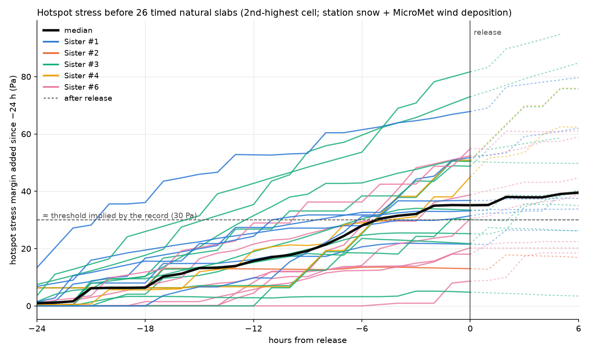
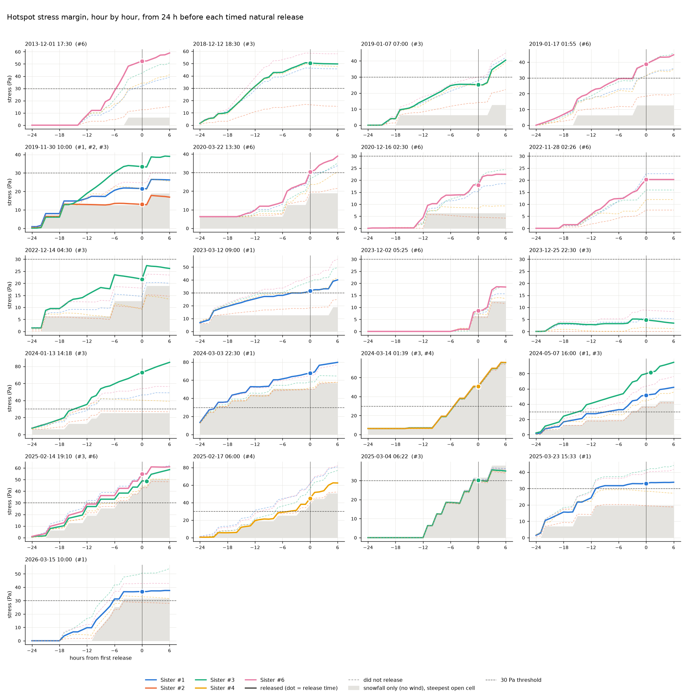

# Wind Loading, Local Shear Stress and Natural Slab Release
### Seven Sisters, Loveland Pass — internal research note (November 2026)

---

## Foreword — do natural slabs start in shear?

Skier-triggered slabs are thought to start as a mixed-mode *anticrack*: a local, fast overload collapses the weak layer and the collapse propagates (Heierli et al. 2008; Gaume et al. 2018). The question behind this note is whether natural slabs can start differently — as a **slow shear failure** under storm loading, in the way laboratory frictional ruptures nucleate (Gvirtzman et al. 2025).

**The proposed sequence.**
1. Where local shear stress passes a weak-layer threshold τ_thresh, a patch starts to fail and grows slowly. The paper puts the time to fast rupture at T ≈ α / (τ − τ_thresh), so it shortens as the excess stress grows.
2. While it is small, the patch is confined and its growth is controlled by the stress threshold. Once it reaches the critical crack length, classical fracture mechanics take over and the crack runs. Confinement therefore matters only in the nucleation phase, not for the whole failure. Fast propagation can still involve weak-layer collapse, and on steep slopes it can become supershear (Trottet et al. 2022). How a slab *starts* and how the crack *propagates* are separate questions.
3. Sintering competes with growth. A weak layer heals while the patch grows, so release needs loading to outpace healing. Rapid loading raises τ − τ_thresh quickly and shortens T. A patch whose edges keep moving also meets fresh, unsintered contacts. Both favour release during fast loading, consistent with the field rule that 30 cm in one day is far worse than 10 cm a day for three days. This is the classic shear-band picture of natural release (McClung 1979; Bader & Salm 1990) in the paper's terms.

**What the Sisters data show — consistent with this picture:**
- Natural releases have a stress threshold (≈ 30 Pa of added shear-stress margin), and the release rate rises with the excess above it (§5.8).
- The last 24 h of loading carry the timing signal; older load adds nothing (§5.11). This fits older load having strengthened by sintering.
- In all 26 releases with a recorded time, loading was still going on, by snowfall or wind transport, mostly within hours of release. In 18 of 26 the modelled hotspot stress was still rising (§5.12). None released after loading had clearly stopped.
- They were cold, dry storm releases (−4 to −19 °C), not warming events.

**What the data cannot show.** None of this tells shear initiation from collapse initiation. On a given cell, shear and normal stress both scale with the same load, so any threshold model — a collapse-driven one included — predicts a threshold, a rate rising with the excess, and release during loading. The data are **consistent with, not evidence for,** shear-initiated natural release.

**Tests that could tell the two apart:**
- **Normal-stress-only model.** Rerun the storm test with the stress margin replaced by normal stress alone (g·SWE·cos²θ). If the shear term (tanθ − μ) is what matters, day and path prediction should get worse. This uses the existing model.
- **Excess stress vs time to release.** Slow shear nucleation predicts that larger excess stress shortens the delay to release. This needs more releases with accurate times.
- **Field observation.** Bed-surface and crown geometry of naturals vs skier-triggered slabs, or seismic and acoustic monitoring for slow precursors in a start zone.

---

## Summary

- **Loading, not terrain, separates the paths.** Shear stress per unit load (∝ sinθ cosθ) is almost identical across the five start zones (0.484–0.490), and zone steepness does not track natural releases (ρ = 0.2). What differs is where wind-transported snow can land.
- **Wind landing sites match the release record and field observation.** Sisters #1, #3, #4 and #6 have steep open cells where W–NW (and, for #1 and #6, SW) winds deposit snow; **Sister #2 has none** (0 m² of W–NW landing area), as observed in the field — and it has one natural slab in 17 seasons.
- **A terrain + wind + snowfall stress model reproduces the zone pattern.** Expected natural-release days per zone (from days with a stress hotspot above threshold) are 6.4 / 1.8 / 9.0 / 4.0 / 10.9 against 8 / 1 / 12 / 3 / 8 observed (Sisters #1 / #2 / #3 / #4 / #6; ρ = 0.82), stable across model settings.
- **Storm by storm, the same model predicts natural slab days and which path releases.** The pre-registered test (72-h load, P99 weak-layer stress margin) gives **AUC 0.76 (95 % CI 0.67–0.84, p = 0.001)** over 32 natural events in 16 seasons, and on natural days it ranks the released path above the others (**AUC 0.74, p < 0.001**). Snowfall sets the timing (AUC 0.71 alone) but cannot pick the path; wind loading does.
- **The 2021–2026 events score as well as the development period** (AUC 0.82). Two model changes — a redrawn Sister #6 start zone and a forest-edge correction — were made after those events were available, though not tuned on them; before the changes the 2021–2026 AUC was already 0.81.
- **The record implies a stress threshold, and the release rate grows with the excess above it — the paper's pattern.** The threshold that best separates natural days is ≈ 30 Pa of added stress margin from 72-h loading (95 % CI 26–67 Pa; ≈ 14 mm SWE of new load on a 45° slope). 29 of 32 naturals occurred on a day their path had a hotspot above it, and per-path hotspot days rank like natural counts (ρ = 0.82). Naturals are ~20× more frequent at > 80 Pa than below 30 Pa (+20 % odds per 10 Pa). Exceeding the threshold is close to necessary but far from sufficient (only 0.2–0.6 % of hotspot days release) — weak-layer state, not in the model, is the likely missing factor.
- **W–NW loading of hotspot terrain tracks the paths' natural counts.** Days per season on which W–NW winds add ≥ 10 Pa to a hotspot patch rank the five paths exactly as their natural days (ρ = 0.97, exact p = 0.033, the minimum attainable); SW loading days do not (ρ ≈ 0.7). Sister #2 gets no W–NW loading days at all.
- **The last 24 hours of loading carry the timing signal.** Stress from the release day's load predicts natural days better (AUC 0.83; 0.86 with known-date events) than the 72-h load (0.76), and once it is known the earlier 48 h add nothing. At equal 72-h stress, loading concentrated in one day looks ≈ 3× worse than spread loading, but that is not significant (p = 0.2).
- **Timed releases happen during loading.** For the 26 naturals with a recorded release time, modelled hotspot stress rose from a median of 16 Pa at −12 h to 35 Pa at release, still rising in 18 of 26. Wind transport or snowfall was going on before every release (§5.12, anecdotal).
- **Larger naturals follow higher hotspot stress, weakly.** Median hotspot stress rises from 39 Pa (D1) to 69 Pa (D1.5) and 93 Pa (D2); ρ = 0.32 with D size (p = 0.07), 0.43 (p = 0.015) without one wind-loaded D2.5 outlier.
- **Remaining caveats:** five zones (no zone-level correlation reaches significance), modelled rather than measured loading, and saltation-only transport. A snow-on drone survey is the most valuable next step.

---

## 1. Motivation and framework

Natural slab avalanches on the Seven Sisters paths threaten US-6 over Loveland Pass. All paths share the same storms and are controlled together, yet some release naturally far more often than others. The question is which terrain and loading conditions make a path release on its own.

**Inspiration.** Gvirtzman, Kammer, Adda-Bedia & Fineberg (2025), *How frictional ruptures and earthquakes nucleate and evolve* (Nature 637, 369–374), show in laboratory friction experiments that rupture nucleation is governed by a **local stress threshold**: a slowly expanding patch starts wherever the local shear stress exceeds τ_thresh, and its time to dynamic rupture shortens as the excess stress grows (T ≈ α / (τ − τ_thresh)), so the nucleation rate scales with τ − τ_thresh. The paper does not discuss snow; the application to slabs is this project's analogy. *(An earlier version of this note mis-cited the paper as a snow-avalanche study; that is corrected here.)*

**What carries over to slabs.** In the paper, a nucleating patch transitions to classical fracture when it spans the confining width of the interface. For a slab, the transition comes when the patch reaches the critical crack length. Confinement shapes the nucleation phase up to that point; after it, classical fracture mechanics apply. Path width (tens of metres) is far larger than the critical crack length (tens of centimetres to a few slab thicknesses), so path boundaries are not expected to matter. What does carry over is that **nucleation is local**: what matters is whether, how often and by how much parts of a start zone exceed the threshold — not the zone's average condition. This note therefore maps stress cell by cell and looks for **hotspots** at or above the critical crack length.

**Stress model.** For a slab of vertical snow load (SWE) on slope θ:

- shear stress τ = g·SWE·sinθ cosθ, normal stress σ = g·SWE·cos²θ, so τ/σ = tanθ;
- for a friction-type weak layer (τ > c + μσ), the stress margin is **g·SWE·cos²θ·(tanθ − μ)**, used throughout with μ = tan 30°.

Load raises the margin only where tanθ > μ. Because sinθ cosθ is nearly flat between ~37° and 45°, **differences in shear stress between these zones must come mostly from differences in load — that is, from wind deposition.**

---

## 2. Site

Seven Sisters is a set of avalanche paths on the north side of the ridge above US-6, west of the Loveland Pass summit (start zones ≈ 39.677° N, 105.891° W, 3,460–3,620 m). CDOT controls the paths with explosives (hand charges and Avalauncher); every mission includes all paths. Five start zones are analysed: Sisters #1, #2, #3, #4 and #6, which are all the active paths. There is no Sister #5 on the ground (the two CAIC records under that name are presumably misattributions), and Sister #7 is not an active path. Sisters #2–#4 start among spruce forest; Sisters #1 and #6 start in open alpine terrain (Figure 1).

| Zone | Area (m²) | Natural HS/SS 2009–2026 | Slab on control days (2009–2021) |
|---|---|---|---|
| Sister #1 | 2,896 | 10 | 67 % |
| Sister #2 | 2,884 | 1 | 45 % |
| Sister #3 | 2,384 | 12 | 61 % |
| Sister #4 | 1,416 | 4 | 55 % |
| Sister #6 | 3,840 | 9 | 53 % |

Natural counts are compared per path, not per unit area: what matters is whether a zone has hotspots and whether they get loaded, not what share of the zone they occupy.

*Control-day column: share of the 198 recorded control days on which explosives released a slab on that path.*

Because all paths are shot on every mission, mitigation affects the paths equally, so natural counts are comparable across paths.

**Field observations.** Sister #1's naturals have been seen to start on the west (skier's-left) side of the gully below the top of the start zone, during windy periods. Sister #2 is exposed mainly to W–NW winds with no place for wind-transported snow to land, and sits too low on the slope to be affected by SW winds; Sisters #1, #3 and #4 have locations where W–NW winds can load.


*Figure 1. Slope inside the five start zones on USGS NAIP imagery (0.6 m, 2019-09-22), with 10 m contours from 3DEP (north up; slopes face north, so the top of each start zone is its southern edge).*

---

## 3. Data

**Terrain.** USGS 3DEP 1 m bare-earth lidar DEM (DRCOG 2020; tile `USGS_1M_13_x42y440_CO_DRCOG_2020_B20`), resampled to 1.2 m (cubic) for the start-zone analysis and 2 m for the wind models. A 5 cm drone photogrammetry surface (file dated 2026-09-22; RTK GCPs surveyed 2026-10-20) includes forest canopy (trees up to ~20 m) and is used only to map canopy (drone surface minus 3DEP). After removing a constant ~11.9 m vertical datum offset, the two agree to 0.35 m (NMAD) on open ground with no horizontal shift. Map backgrounds use USGS NAIP imagery (0.6 m, 2019-09-22).

> Averaging 1 m data onto a 1.2 m grid leaves a periodic 5-pixel ripple in curvature (a 10× spectral spike); cubic resampling removes it. Per-zone slope is computed on the full DEM and then masked: computing it on clipped zone DEMs biases edge cells low.

**Start zones.** Hand-digitised KML polygons. Sister #1 was re-digitised in November 2026 (now 2,901 m², centred 40 m further north, i.e. downslope, overlapping the old polygon by 1,126 m²). **Sister #6 was redrawn in November 2026** (now 3,840 m², up from 579 m²; it contains the old polygon and extends ~31 m north and ~15 m west, taking in the upper west edge where SW loading concentrates). The combined start-zone polygon is the union of the per-zone polygons.

**Avalanches.** Natural (N) hard and soft slabs (HS, SS), from two sources:

- the named CAIC highway observer export, 2009 – 2021-05-04 (re-exported 2026);
- a 2026 CAIC export of natural slabs with coordinates but no path names (2020 – 2026-03). Records were matched to paths by tracing each start zone downhill on the 3DEP DEM and assigning each record to the nearest traced corridor within 40 m (ties → the path aligned across the slope). In the overlap period, every record found in both exports had the same path, size and type. 24 records matched the Sisters; 19 were new and were added (`src/assign_avalanche_paths.py`, `src/merge_avalanche_records.py`). Two overlapping events are logged as explosive-triggered in the highway export and natural in the 2026 export (2020-11-14 Sister #6, 2021-02-06 Sister #1); they are kept as explosive-triggered pending verification, since each would add one natural to a small dataset.

Below-treeline records on Sister #6 are excluded as likely runout misattributions; Sister #6's TL band is alpine and counts with >TL. The 2026 export contains naturals only, so control missions are known only to 2021-05-04.

**Weather** (CAIC database, hourly, Oct 2009 – Jun 2026):

- **CALVP** — CAIC/CDOT ridge station, 3,624 m, on the crest ~380 m SW of the start zones (wind speed, direction, temperature).
- **LBAC2** — Loveland Basin SNOTEL (SWE, in hundredths of an inch). Water year 2011 is missing at both stations and 2019 has half the wind record; snow depth carries a flag value (2000) through 2010–14 and is not used.

---

## 4. Methods

### 4.1 Zone steepness

Mean tanθ, share of cells > 40° and mean sinθ cosθ per zone (Horn slope on the full 1.2 m DEM). Slab-scale sensitivity: the DEM smoothed to 5, 10 and 20 m.

### 4.2 Transport winds

Transport hours at CALVP: wind ≥ 15 mph (6.7 m/s), air temperature below 0 °C and ≥ 0.3 in SWE gain at LBAC2 over the previous 72 h.

### 4.3 Fetch (Winstral)

For each wind direction: Winstral's upwind shelter index Sx (100 m search, ±15° sector) and the upwind source area of each zone — rays marched up to 1 km upwind, stopping at a slope-break snow trap (Sb > 15°, 50 m separation), at forest, or at the data edge (traps within 50 m of the zone ignored). **Fetch ratio** = source area / zone area.

### 4.4 MicroMet terrain winds and saltation transport

1. **Terrain winds** (Liston & Elder 2006): W = 1 + 0.5·Ωs + 0.5·Ωc (Ωs slope in the wind direction, Ωc curvature over η = 30 m, each scaled to ±0.5); local speed = CALVP speed × W(cell) / W(station).
2. **Threshold** (10-m speed): 5 m/s with ≥ 2.5 mm SWE in the previous 24 h; otherwise Li & Pomeroy (1997) dry snow, 9.43 + 0.18T + 0.0033T² m/s; no transport above 0 °C.
3. **Capacity**: Pomeroy & Gray (1990) saltation flux (suspension omitted).
4. **Erosion / deposition**: downwind marching; flux relaxes toward rising capacity over Lf = 100 m and deposits where capacity falls (lees, gully floors, forest).

Every hour of record is run (kg/m² = mm SWE). Sensitivity: η = 15, 60 m and Lf = 50, 200 m.

### 4.5 Landing sites, stress hotspots and nucleation potential

- **Landing sites**: steep (35–55°) open cells collecting more than 50 mm SWE per season of wind deposition, by wind sector.
- **Stress margin** per cell with load = snowfall + wind deposition, reduced to zero between 50° and 60° (snow does not build slabs on very steep rock). **Cells within 4 m of forest canopy carry no slab stress**: trees anchor the snowpack, and the transport model dumps the intercepted flux at the tree line. *(This correction was found while investigating Sister #2: its few extreme-deposition cells, holding 70 % of its deposition, all sat at forest edges — not open slab terrain.)*
- **Hotspots**: top 5 % of margin among all start-zone cells pooled, in connected patches (MicroMet season-average loading; a fetch-index geometry is a robustness check).
- **Nucleation potential** (following the paper, rate ∝ τ − τ_thresh): for every day, the 72-h stress margin minus a threshold (P99 of start-zone margins; P95 as a check), positive part, summed over all days per season. **Expected release days** per zone are proportional to the zone's days with a hotspot patch (≥ 2 cells above threshold) or to its summed excess, scaled to the observed total.
- **Wind-deposition multiplier**: load = snowfall + k · wind deposition, k = 0–50, threshold recomputed for each k — does the zone pattern need stronger (or no) wind loading?

### 4.6 Storm-by-storm test

For every day November–May, each zone's load is snowfall plus MicroMet wind accumulation in the preceding 72 h (variants: load since the last control mission, evaluated only to 2021-05-04, with and without 5-day settling; stress on wind-loaded cells only). Outcome: a natural slab on that path that day. **Primary test, chosen before the results:** 72-h window, P99 stress margin. Statistics: AUC with a cluster bootstrap 95 % CI (event days and seasons resampled), a date-shift permutation test (event days moved ±10–60 days within the season), a within-day permutation test (is the released path ranked above the other paths that day?), and a period split: 2009–2021 (development) vs 2021–2026. Zone-level correlations use exact permutation p-values (minimum two-sided p 0.017 with N = 5).

### 4.7 Stress threshold and avalanche size

A zone has a **hotspot day** at threshold t when its 2nd-highest cell stress margin (72-h load) exceeds t — a patch of ≥ 2 cells, about critical-crack-length scale. Scanning t from 5 to 400 Pa gives the hit rate H = P(hotspot | natural day), the false-alarm rate F = P(hotspot | other days) and the Peirce skill H − F; the threshold maximising it is the record's estimate of τ_thresh, with a season-block bootstrap CI. The stress is the margin *added* by the last 72 h of loading, so the threshold is an increment, not the weak layer's total strength; it is also expressed as the equivalent new SWE on a 45° slope, t / (g·cos²θ·(tanθ − μ)). Release rates are tabulated by hotspot-stress bin, with a logistic trend. Avalanche size (destructive D and relative R) is compared with the release day's hotspot stress, area above the P95 stress threshold, new snow and wind deposition (Spearman, permutation p).

---

## 5. Results

### 5.1 Steepness alone

| Zone | Mean slope | % cells > 40° | Mean tanθ (τ/σ) | Mean sinθ cosθ (τ per load) |
|---|---|---|---|---|
| Sister #1 | 41.4° | 56.6 | 0.895 | 0.490 |
| Sister #2 | 40.6° | 52.2 | 0.865 | 0.490 |
| Sister #3 | 44.7° | 79.9 | 1.010 | 0.490 |
| Sister #4 | 45.1° | 78.9 | 1.035 | 0.487 |
| Sister #6 | 40.5° | 56.4 | 0.862 | 0.488 |

Shear stress per unit load varies by about 1 % between zones, and steepness does not track natural releases (mean tanθ vs count: ρ = 0.2, exact p = 0.78). Sister #2 is as steep as Sisters #1 and #6 yet has one natural against their 10 and 9. Sister #4's steepness is mostly small-scale relief (smoothed to 20 m its share of cells > 40° drops from 79 % to 55 %).

### 5.2 Transport winds and the weather before naturals

Snow-transporting winds at the ridge are bimodal: **WNW (≈ 290–300°)** and **WSW (≈ 245–250°)**.


*Figure 2. CALVP transport winds (direction from).*

Before Sister #6's naturals (10 events), **58 %** of transport flux came from the SW, against **31 %** before Sisters #1–#4's naturals (27 events) and 42 % on all winter days; #1–#4 naturals followed WNW-dominated transport (54 % vs 47 %). Sisters #1–#4 released after larger storms (median 72-h new snow at the 84th percentile of winter days), Sister #6 after ordinary ones (53rd percentile) — consistent with Sister #6 being loaded mainly by wind.

### 5.3 Loading

**Fetch.** Fetch ratios rank #6 (16) > #1 (11) > #3 (3.5) ≈ #2 (3.1) > #4 (1.3) (order robust to the trap / grace / length settings; magnitudes are not).

**MicroMet.**

| Zone | Wind accumulation, mm SWE / season (mean) | of which SW | of which W–NW | 90th percentile |
|---|---|---|---|---|
| Sister #1 | **+85** | +75 | +11 | +354 |
| Sister #6 | **+40** | +53 | −12 | +227 |
| Sister #2 | −52 | −6 | −43 | −19 |
| Sister #3 | −79 | −20 | −56 | +107 |
| Sister #4 | −86 | −25 | −58 | +24 |

Across sensitivity runs (η 15/30/60 m, Lf 50/100/200 m) the order **#1 > #6 > #2 > #3 > #4 never changes**. Zone means hide the pockets that matter: Sisters #3 and #4 are net-eroded but have positive upper percentiles (§5.4).


*Figure 3. MicroMet / saltation wind accumulation per season (blue deposition, red erosion, green forest), all transport and by sector. North up.*


*Figure 4. Close-ups of Sister #1 and Sister #6 by wind sector (north up; top of each start zone at the bottom).*

### 5.4 Landing sites — why Sister #2 is quiet

| Zone | W–NW landing area | share of zone | SW landing area | Naturals |
|---|---|---|---|---|
| Sister #1 | 540 m² | 19 % | 1,056 m² | 10 |
| Sister #6 | 312 m² | 8 % | 1,428 m² | 9 |
| Sister #3 | 140 m² | 6 % | 260 m² | 12 |
| Sister #4 | 24 m² | 2 % | 72 m² | 4 |
| **Sister #2** | **0 m²** | **0 %** | 136 m² | **1** |

*Steep (35–55°) open cells (> 4 m from canopy) collecting > 50 mm SWE / season.*

The model independently reproduces the field description: **Sister #2 has no W–NW landing sites** (zero in four of five sensitivity runs), while Sisters #1, #3 and #4 do. The model does give Sister #2 some SW landing area (136 m²), whereas the field observation is that it sits too low on the slope for SW winds — the model may overstate SW exposure at that elevation. Before the forest-edge correction, Sister #2's apparent deposition came from five forest-edge cells; with them excluded its open slab terrain is scoured, not loaded.

### 5.5 Stress hotspots

| Zone | MicroMet load: hotspot area / patches | Fetch-index load: hotspot area / patches | Naturals |
|---|---|---|---|
| Sister #3 | 132 m² / 1 | 105 m² / 3 | 12 |
| Sister #1 | 276 m² / 5 | 251 m² / 9 | 10 |
| Sister #6 | 228 m² / 4 | 266 m² / 8 | 9 |
| Sister #4 | 12 m² / 1 | 9 m² / 1 | 4 |
| Sister #2 | 0 | 0 | 1 |

Both loading variants put Sister #2 at zero hotspot area and Sister #4 near zero; hotspot area vs natural count gives ρ = 0.70 (exact p = 0.23, N = 5). **Field check — Sister #1:** 99 % of its hotspot area lies in the west half of the zone, matching where its naturals have been seen to start. (Most zones have their hotspots on the west side, as expected for W–WNW winds loading east-facing walls, so this is consistent rather than discriminating.)



*Figure 5. Fetch-index deposition (left) and stress margin with top-5 % hotspot patches in red (right). North up.*

### 5.6 Nucleation potential and observed vs expected

| | Sister #1 | Sister #2 | Sister #3 | Sister #4 | Sister #6 |
|---|---|---|---|---|---|
| Observed natural days (with weather data) | 8 | 1 | 12 | 3 | 8 |
| Expected — hotspot days | 6.4 | 1.8 | 9.0 | 4.0 | 10.9 |
| Expected — summed excess | 7.5 | 3.9 | 8.3 | 2.8 | 9.5 |

*P99 threshold; expected values scaled to the observed total of 32. Hotspot-days fit: Poisson deviance 2.8, ρ = 0.82; across sensitivity runs deviance 2.5–5.1, ρ 0.82–0.97, Sister #2 expected 1.5–2.6.*

Every observed count lies within its expected value's Poisson range. This was not true before the two November corrections: with the old Sister #6 polygon and forest-edge cells counted, the model expected about one natural day on Sister #6 (8 observed) and 6–12 on Sister #2 (1 observed).

**Wind multiplier.** With no wind term (k = 0, snowfall × terrain only) the zone pattern fits worse (deviance 7.4–13.3 for the two main bases; restricting stress to wind-loaded cells, which already uses where the wind deposits, fits well even at k = 0, deviance 3.3); with the model's wind deposition as built (k = 1) it fits well (deviance 2.8), and doubling it (k = 2) fits about equally (1.9). Storm-level path picking also peaks at k ≈ 1–2 (within-day AUC 0.64 at k = 0, 0.74 at k = 1–2). The modelled wind loading is therefore roughly the right strength — not an order of magnitude too weak — once deposition is restricted to open slab terrain.

**Release points.** Seven 2020–2026 release points fall inside start zones; they sit at the 0th–81st percentile of potential within their zone (median 58th). One Sister #6 point lies on a zero-potential cell, so this check is inconclusive.


*Figure 6. Left: nucleation potential (Σ excess stress above the P99 threshold per season; forest and forest-edge cells masked) on NAIP imagery, with natural release points (stars inside start zones, circles on tracks). Right: observed natural-release days on days with weather data — 32 of the 36 naturals; four (2018-04-03 on #1, #4 and #6, and 2018-11-19 on #1) fall in weather-data gaps — with 95 % Poisson CIs, against expected days from hotspot days and from summed excess, scaled to the observed total.*

### 5.7 Storm-by-storm skill

| Test | Events | AUC (95 % CI) | Date-shift p | Within-day AUC (p) |
|---|---|---|---|---|
| **Primary: 72-h, P99 stress margin** | 32 | **0.76 (0.67–0.84)** | **0.001** | **0.74 (< 0.001)** |
| Primary, 2009–2021 | 15 | 0.70 (0.58–0.82) | 0.046 | 0.78 (0.002) |
| Primary, 2021–2026 | 17 | 0.82 (0.69–0.91) | 0.002 | 0.70 (0.017) |
| 72-h snowfall only | 32 | 0.71 (0.62–0.80) | < 0.001 | 0.50 (—) |
| 72-h wind accumulation only | 32 | 0.58 (0.44–0.72) | 0.63 | 0.62 (0.033) |
| Stress on wind-loaded cells only | 32 | 0.73 (0.64–0.82) | 0.002 | 0.70 (0.001) |
| Since control, 5-d settling (to 2021) | 15 | 0.69 (0.58–0.82) | 0.015 | 0.70 (0.018) |

*Sensitivity runs: primary AUC 0.75–0.77, within-day 0.72–0.74.*

- **Natural days are predictable from the 72-h stress margin, and so is the path.** Snowfall alone identifies natural days nearly as well but cannot pick the path; adding terrain and wind loading picks the released path on 74 % of comparisons.
- **The 2021–2026 events score as well as 2009–2021.** They were not used to fit any parameter, but two model changes (the redrawn Sister #6 polygon and the forest-edge rule) were made after they were in hand. Before those changes, the 2021–2026 AUC was 0.81 (within-day 0.62), so the timing skill does not depend on them; the improvement in path picking does.
- **Recent loading matters.** Load accumulated since the last control mission without settling does worse; with 5-day settling it is comparable. Natural releases follow loading from the last few days, consistent with older load gaining strength and with the paper's excess-stress / time-to-failure relation.

### 5.8 What stress threshold does the record imply?

The model's working threshold (pooled P99 of start-zone stress) is 76 Pa, ≈ 37 mm SWE of new load in 72 h on a 45° slope. Scanning thresholds, the one that best separates natural days is **≈ 30 Pa (95 % CI 26–67 Pa), ≈ 14 mm SWE in 72 h on a 45° slope (12–32 mm)**: hit rate 0.91, false-alarm rate 0.50, Peirce skill 0.41. The skill curve is broad and flat between ~25 and 70 Pa, hence the wide interval.

| Path | Hotspot days / season (> 30 Pa) | Natural days | Naturals on a hotspot day |
|---|---|---|---|
| Sister #6 | 133 | 8 | 8 of 8 |
| Sister #3 | 122 | 12 | 11 of 12 |
| Sister #1 | 117 | 8 | 7 of 8 |
| Sister #4 | 79 | 3 | 3 of 3 |
| Sister #2 | 50 | 1 | 0 of 1 |

- **Exceeding the threshold is close to necessary**: 29 of 32 naturals occurred on a day their path had a hotspot above it, and hotspot days per path rank like the natural counts (ρ = 0.82 for any threshold from 15 to 140 Pa).
- **It is far from sufficient**: at 30 Pa a path has a hotspot on about half of all winter days, and only 0.2–0.6 % of hotspot days produce a natural.

| Hotspot stress | Zone-days | Naturals | per 1,000 zone-days (95 % CI) |
|---|---|---|---|
| < 15 Pa | 4,889 | 2 | 0.4 (0.05–1.5) |
| 15–30 Pa | 3,295 | 1 | 0.3 (0.01–1.7) |
| 30–45 Pa | 2,661 | 9 | 3.4 (1.6–6.4) |
| 45–60 Pa | 1,896 | 3 | 1.6 (0.3–4.6) |
| 60–80 Pa | 1,587 | 4 | 2.5 (0.7–6.5) |
| 80–110 Pa | 1,203 | 9 | 7.5 (3.4–14.2) |
| > 110 Pa | 594 | 4 | 6.7 (1.8–17.2) |

**The release rate shows the paper's pattern: an onset at a threshold, then a rate that grows with the excess stress.** Naturals are rare below 30 Pa and about 20 times more frequent above 80 Pa; a logistic trend gives +20 % odds of a natural per additional 10 Pa (95 % CI 12–28 %; zone-days treated as independent, so the interval is optimistic).

Why exceedance is not sufficient: (1) the paper's threshold is location- and state-dependent, while the model uses one fixed value — the presence and strength of a weak layer, not modelled here, is probably the main missing factor; (2) control missions are fired on the most heavily loaded days and remove slabs before they can release naturally; (3) the stress counts only the last 72 h of loading.

**Control missions cannot be treated as simple censoring.** Of the 15 natural zone-days in 2009–2021 (control records end 2021-05-04), 10 fall on a control day or the day after. Crews go out after storms — when natural cycles happen — and that is also when observers are on site to see and log naturals. Removing control days therefore removes most of the naturals too (the remaining 5 all fall on hotspot days, H = 1.0, but that is too few to interpret). This also suggests the natural record is tied to observer presence: naturals between missions are likely logged late, with estimated dates, or not at all.



*Figure 7. Left: hit rate, false-alarm rate and Peirce skill against the stress-margin threshold (72-h loading; top axis: equivalent new SWE on a 45° slope); grey band = 95 % CI of the best threshold. Right: hotspot days per season above 30 Pa and natural slab days per path (labels: naturals on a hotspot day / all naturals).*

### 5.9 Avalanche size

| | Hotspot stress | Area above 44 Pa | 72-h new snow |
|---|---|---|---|
| D1 (n = 8) | 39 Pa | 2 m² | 8 mm |
| D1.5 (n = 17) | 69 Pa | 88 m² | 9 mm |
| D2 (n = 6) | 93 Pa | 248 m² | 21 mm |
| D2.5 (n = 1) | 34 Pa | 0 m² | 0 mm |

*Medians on the release day.*

Larger naturals follow higher hotspot stress and more stressed area, but weakly: Spearman ρ with D size = 0.32 for hotspot stress (permutation p = 0.07), 0.24 for stressed area (p = 0.19) and 0.27 for new snow (p = 0.13); wind deposition alone shows no relation. The single D2.5 event — 2021-01-24 on Sister #6, a hard slab after WSW winds to 28 mph with almost no new snow, from a coordinate-assigned record with an estimated date — is the model's largest miss (34 Pa); without it, ρ = 0.43 for hotspot stress (p = 0.015) and 0.39 for new snow (p = 0.03). That event looks like wind loading the saltation-only model under-represents. The paper would predict that nucleation follows local excess stress while size follows the extent of stressed slab; hotspot stress and stressed area are driven by the same loading and are strongly correlated here, so these data cannot separate the two. Size also depends on the path itself (median D1 on Sister #1, D2 on Sister #4), and the size classes are coarse.

### 5.10 Loading days by wind direction

How often does each wind direction load each path's hotspot terrain? For each path and day, the MicroMet run gives the weak-layer stress that the wind deposition from each 10° direction adds to the path's stress-bearing cells (open, tanθ > μ, < 60°), taken at the 2nd-highest cell (a ≥ 2-cell patch). A **loading day** from a sector is a day on which that sector adds ≥ 10 Pa (≈ 5 mm SWE on a 45° slope) to such a patch (`src/loading_days.py`; 10° bins within a sector summed).

| Path | SW loading days / season | W–NW loading days / season | Natural days |
|---|---|---|---|
| Sister #3 | 51.8 | **46.6** | 12 |
| Sister #6 | 62.4 | **37.7** | 8 |
| Sister #1 | 54.1 | **20.7** | 8 |
| Sister #4 | 42.2 | **7.0** | 3 |
| Sister #2 | 7.7 | **0.0** | 1 |

- **W–NW loading days rank the paths exactly as their natural days do** (ρ = 0.97, exact p = 0.033 — the smallest p attainable with a tie in five paths), at 5, 10 and 20 Pa, and also when the 10° bins are combined by maximum instead of sum (lower bound; ρ = 0.97 at 5–10 Pa, 0.79–0.89 at 20–30 Pa). SW loading days do not (ρ = 0.67–0.82, p ≥ 0.13): Sister #4 gets frequent SW loading but has few naturals.
- By 30° bin, loading from 285–315° tracks natural days best (ρ = 0.97), 255–285° less (0.82), 225–255° least (0.67).
- **Before naturals, the path had been loaded:** 29 of 32 natural days had a loading day on that path in the 72-h window (all zone-days: 57 %). SW loading preceded 22 (69 % vs 40 %, lift 1.7), W–NW loading 14 (44 % vs 24 %, lift 1.8). All 8 Sister #6 natural days followed SW loading (lift 1.8), consistent with its SW exposure; Sister #1's naturals followed W–NW loading twice as often as its other days.
- Per loading day, natural rates are similar across #1, #3 and #6 (0.3–0.5 per 100 days), lower for #4 (0.17) and zero for #2.

This is the zone-level counterpart of §5.4: Sister #2 is the path the W–NW winds never load. The test is exploratory: N = 5, several thresholds and sectors were examined, and the correlation reaches the smallest p the data allow rather than conventional significance by a margin.


*Figure 8. Left: days per season on which SW and W–NW winds add ≥ 10 Pa to a ≥ 2-cell patch of each path's stress-bearing cells, with natural slab days (diamonds). Right: loading days by 30° wind-from bin.*

### 5.11 Loading rate: does the last 24 h matter?

Field experience says rapid loading is far worse than the same load spread over days (30 cm in one day vs 10 cm a day for three days). In the nucleation picture, a patch grows for T ≈ α / (τ − τ_thresh) before dynamic rupture; fast loading raises τ − τ_thresh quickly, shortening T and leaving less time for the weak layer to strengthen by sintering (and an expanding patch keeps exposing fresh, unsintered contacts). The model was rerun with 24- and 48-h loading windows and with the stress from each single day's load (`src/loading_rate.py`).

| Load (2nd-highest-cell stress margin) | AUC, all zone-days (95 % CI) | AUC, known-date events only (26) | Within-day AUC (path picking) |
|---|---|---|---|
| **24-h window (release day)** | **0.83 (0.74–0.90)** | **0.86** | 0.71 |
| 48-h window | 0.81 (0.73–0.87) | 0.82 | 0.69 |
| 72-h window (primary test) | 0.76 (0.68–0.82) | 0.77 | **0.74** |
| Release day alone / day before / two days before | 0.83 / 0.68 / 0.56 | | |

- **The last 24 h carry the signal.** In a logistic model with both, the 24-h stress is strong (p = 0.012; p < 0.001 with known-date events only) and the 72-h stress adds nothing (coefficient ≈ 0, p = 0.5); equivalently, given the release day's load, the preceding 48 h add nothing (p = 0.38). AIC improves by 22 over the 72-h model.
- Every one of the 32 natural days had loading on that path on the release day. On natural days the release-day stress (median 36 Pa) was about as large as the preceding 48 h (35 Pa); on loaded days without a natural it was half as large (19 vs 39 Pa).
- **Path picking still prefers 72 h** (within-day 0.74 vs 0.71): which path releases depends on where wind has deposited over several days; when it releases depends on the last day.
- **Rate at a fixed total is suggestive, not established.** At equal 72-h stress, the odds of a natural are ≈ 3× higher when all of the 3-day load came in one day than when it was evenly spread (logistic, 95 % CI includes 1, p = 0.20; for snowfall concentration alone p = 0.05). Only 432 loaded zone-days had ≥ 80 % of their load in one day, with 3 naturals (9 per 1,000 at 30–60 Pa vs 2–2.4 for spread or mixed loading).

Caveats: the release day's load includes any hours after the release; daily resolution cannot separate *fast* from *recent* loading; and naturals are logged when observers are out, which is often during or just after storms (§5.8). Hour-by-hour stress for the 26 naturals that have a release time is in §5.12.

This supports the reading that recent loading drives natural release and older load does not count — consistent with older load having strengthened (sintering) or relaxed, and with the excess-stress / time-to-failure relation. It does not by itself establish shear-initiated nucleation; a normal-stress-only variant of the stress model would be the next discriminating test.

### 5.12 Hotspot stress before timed releases (anecdotal)

26 Sisters natural slabs have a recorded release time, in 21 storms. 9 records are flagged in the CAIC highway export (3 known, 6 estimated). 17 come from the 2020–2026 export, which gives times but leaves the flag empty; many are to the minute and look observed. One estimated-date record at 12:00 AM is a placeholder and was dropped. For each event, the model was rerun hour by hour from 24 h before release to 6 h after (`src/event_stress_timeline.py`). Load is station snowfall (LBAC2, 3-h median) plus MicroMet wind deposition, with the same winds, thresholds and transport as §4.4. The stress is the 2nd-highest cell in each start zone, as in §4.7. The CALVP and LBAC2 station records around each release were checked as well.

- **Stress builds through the day and fastest near release.** Median hotspot stress was 16 Pa at −12 h, 28 Pa at −6 h and 35 Pa at release, so over half of the 24-h stress came in the last 12 h. 18 of 26 were at or above the 30 Pa threshold of §5.8 at release.
- **Most releases came while stress was still rising.** In 18 of 26, hotspot stress rose by more than 1 Pa in the last 3 h. The 8 flat or slightly falling cases are 2019-01-07, 2019-11-30 (#1, #2 and #3), 2022-12-14, 2023-12-25, 2025-03-23 and 2026-03-15; three of them have estimated times.
- **At the station, loading was going on before every release.** In 22 of 26, wind was above the transport threshold in at least 5 of the 6 hours before release; this is true in 40 % of winter hours. The other four had snowfall in the last 6 h (2023-12-02, and 2024-03-14 on #3 and #4, near-calm with 10 mm SWE in 6 h) or NW transport in 4 of the last 6 h (2023-12-25). Snow had last increased within 6 h of release in 15 of 26. None released after both snowfall and transport had stopped. In all 8 cases where modelled hotspot stress was flat, the station still shows transport; the model deposits it away from the hotspot.
- **Some releases came from wind alone.** 2020-12-16 and 2022-11-28 (#6) and 2023-12-25 (#3) had no new snow at the station in the 24 h before release. These are also the events furthest below the threshold (5–20 Pa). Either the model underestimates wind loading there, or load from before the 24-h window mattered.
- **Cold storm releases.** Temperature at release was −4 to −19 °C. Even the afternoon spring events (2020-03-22 13:30, 2024-05-07 16:00–17:00) were near −9 °C, in snow and wind. Only 2025-03-23 (#1, 15:33, −4 °C) could have had a sun or warming component.
- **Picking the path within a storm is weak hour by hour.** The released path had the highest hotspot stress of the five in 9 of 26 cases (about 5 expected by chance). Wind-loaded storms separate the paths clearly, for example 2013-12-01 (#6) and 2024-01-13 (#3). Snowfall-only storms load all paths almost equally, for example 2024-03-14 and 2025-03-04.
- **The release-day window includes load after the slide.** In 20 of 26 cases snow kept falling later the same day; in 8 the post-release share was larger than the 24 h before release (2024-03-14: 20 mm before, 20 mm after). The release-day AUC in §5.11 is therefore somewhat optimistic.

This is anecdotal. There is no matching set of hourly storms without naturals; release times are converted as MST (UTC−7), so March–May times may be an hour off; snowfall resolves in 2.5 mm steps; and observers on the highway mostly see slides during storm operations, so releases after storms may be under-recorded. Still, the pattern is the one expected if loading has to outpace weak-layer healing: release during active loading, mostly within hours of the last increment.



*Figure 9. Hotspot stress margin (2nd-highest cell; station snow plus MicroMet wind deposition, accumulated from −24 h) for the 26 timed natural slabs, aligned at release. Colour = path; bold = median; dotted = after release; dashed line = 30 Pa threshold.*



*Figure 10. The same per storm, for all five paths. Bold lines with dots: released paths and release times. Faint dashed: paths that did not release. Grey: stress from snowfall alone at the steepest open cell — the gap above it is wind loading.*

---

## 6. Limitations

- **Zone count.** Five zones, all the active Sisters paths; no zone-level correlation reaches significance (best p = 0.08–0.23). More zones must come from other sites.
- **Post-hoc corrections.** The Sister #6 polygon was redrawn and the forest-edge rule added after the zone-level mismatch was seen. Both have physical grounds (the release area as known in the field; trees anchoring snow), but they were not pre-specified.
- **Avalanche record.** Many natural dates are estimated, and two-thirds of 2009–2021 naturals were logged on a control day or the day after, so detection depends on when observers are out. Control missions without results are not recorded, and none are available after 2021-05-04. Records from 2020–2026 are assigned to paths by coordinates (observer-placed points, not exact release locations).
- **Snow data.** SNOTEL SWE resolves 2.5 mm steps; one station represents the whole site; water year 2011 is missing.
- **Wind and transport model.** MicroMet is empirical; saltation only (suspension omitted); unlimited erodible snow; no wind-direction diversion in the transport direction; faint streak artefacts along the wind direction. The zone order is robust to model parameters; absolute amounts are not. The model may overstate SW exposure for the lower zones (Sister #2).
- **Deposition not validated against snow.** The canopy mask (drone-derived) affects Sisters #2–#4.
- **Thresholds.** μ = tan 30°, the 50–60° holding cap, the 4 m forest buffer, the P99 threshold and hotspot percentiles are assumptions; alternatives are reported where tested. The data-derived threshold (§5.8) is an increment from 72-h loading, assumes one value for all zones and days, and has a wide interval.
- **Weak-layer state is not modelled.** This is the most likely reason exceeding the stress threshold rarely produces a natural (§5.8).

---

## 7. Next steps

1. **Snow-on drone survey** after a W–NW storm and after a SW storm: snow depth = snow-on minus snow-off, processed with the same GCPs and vertical datum (the drone products sit ~11.9 m below 3DEP). Targets: Sister #1's west wall, Sister #6's upper west edge, and Sister #2 (to confirm it has no landing sites). This measures the load directly.
2. **Add suspension transport** (e.g. Pomeroy & Male 1992 or SnowTran-3D) and check whether the zone pattern holds.
3. **WindNinja** runs for a few key storms to check MicroMet's terrain winds near the start zones, especially SW exposure of the lower zones.
4. **More zones**: extend the analysis to other controlled paths with ridge wind stations.
5. **Verify the two trigger conflicts** (2020-11-14 Sister #6, 2021-02-06 Sister #1) and, if possible, obtain the CDOT control-mission log after 2021.
6. **Weak-layer information**: add a snowpack indicator (e.g. persistent weak layer present, from CAIC observations or a snowpack model such as SNOWPACK driven by CALVP/LBAC2) to the threshold analysis — the step most likely to turn "threshold exceeded" into "release likely".
7. **Normal-stress-only stress model**: rerun the storm test with normal stress (g·SWE·cos²θ) in place of the shear margin. If day and path prediction get worse, that is evidence that the shear term — and shear initiation — matters (Foreword).
8. **Observation timing**: two-thirds of naturals were logged on a control day or the day after, so the record is tied to when crews are out. A CDOT mission log (including missions without results, and after 2021) would let control be modelled properly — as both a slab-removal and an observation process — instead of as simple censoring (§5.8).

---

## Appendix — reproducing

```bash
source .envrc                                                     # conda env (.conda)
python src/assign_avalanche_paths.py data/avalanches/caic-avalanche-records-2026-11-12.csv
python src/merge_avalanche_records.py \
    data/avalanches/CAIC_HWY_avalanches_2009-01-01_2021-05-04.csv \
    figures/seven_sisters_new_records_assigned.csv \
    data/avalanches/CAIC_HWY_avalanches_2009-2026_sisters_merged.csv
python src/sql_util.py --site sisters --end 2026-06-01            # CALVP + LBAC2
python src/pipeline.py --site sisters                             # DEM, zone clips, metrics, Figure 1
python src/wind_exposure.py --site sisters                        # Sx, fetch (§4.3)
python src/storm_analysis.py --site sisters                       # weather before each natural
python src/stress_hotspots.py --site sisters                      # fetch-index hotspots
python src/micromet_loading.py --site sisters                     # MicroMet, landing sites, potential, storm test
python src/event_stats.py --site sisters                          # bootstrap / permutation / period split
python src/threshold_analysis.py --site sisters                   # stress threshold, release rate, size (§5.8–5.9)
python src/loading_days.py --site sisters                         # loading days by wind direction (§5.10)
python src/loading_rate.py --site sisters                         # 24/48/72-h windows, loading rate (§5.11)
python src/event_stress_timeline.py --site sisters                # hourly stress before timed releases (§5.12)
```

The NAIP image (`data/Sisters/NAIP_sisters.tif`) comes from the USGS National Map `USGSNAIPImagery` ImageServer (exportImage, bbox 423100,4391800,424300,4392800, EPSG:26913, 0.6 m). Profile curvature and aspect entropy (earlier hypotheses) are still computed by the pipeline's zone-metric table but are not used here. The earlier rule-based nucleation-candidate map (steep, E-facing near N-facing terrain, convex) has been removed; nucleation sites now come from the nucleation potential, exported by `micromet_loading.py` as `figures/seven_sisters_nucleation_potential.tif` and as a KML of patches at or above the 95th percentile of start-zone potential (`figures/seven_sisters_nucleation.kml`).

## References

- Gvirtzman, S., Kammer, D. S., Adda-Bedia, M. & Fineberg, J. (2025). How frictional ruptures and earthquakes nucleate and evolve. *Nature* 637, 369–374. https://doi.org/10.1038/s41586-024-08287-y
- Bader, H.-P. & Salm, B. (1990). On the mechanics of snow slab release. *Cold Regions Science and Technology* 17, 287–300.
- Heierli, J., Gumbsch, P. & Zaiser, M. (2008). Anticrack nucleation as triggering mechanism for snow slab avalanches. *Science* 321, 240–243.
- Gaume, J., Gast, T., Teran, J., van Herwijnen, A. & Jiang, C. (2018). Dynamic anticrack propagation in snow. *Nature Communications* 9, 3047.
- Li, L. & Pomeroy, J. W. (1997). Estimates of threshold wind speeds for snow transport using meteorological data. *Journal of Applied Meteorology* 36, 205–213.
- Liston, G. E. & Elder, K. (2006). A meteorological distribution system for high-resolution terrestrial modeling (MicroMet). *Journal of Hydrometeorology* 7, 217–234.
- McClung, D. M. (1979). Shear fracture precipitated by strain softening as a mechanism of dry slab avalanche release. *Journal of Geophysical Research* 84(B7), 3519–3526.
- Pomeroy, J. W. & Gray, D. M. (1990). Saltation of snow. *Water Resources Research* 26, 1583–1594.
- Schweizer, J., Jamieson, J. B. & Schneebeli, M. (2003). Snow avalanche formation. *Reviews of Geophysics* 41, 1016.
- Trottet, B., Simenhois, R., Bobillier, G., Bergfeld, B., van Herwijnen, A., Jiang, C. & Gaume, J. (2022). Transition from sub-Rayleigh anticrack to supershear crack propagation in snow avalanches. *Nature Physics* 18, 1094–1098.
- Winstral, A., Elder, K. & Davis, R. E. (2002). Spatial snow modeling of wind-redistributed snow using terrain-based parameters. *Journal of Hydrometeorology* 3, 524–538.
- Colorado Avalanche Information Center (CAIC) highway observer database, 2009–2021, and CAIC avalanche records export, 2026.
- USGS 3D Elevation Program (3DEP), 1 m DEM, DRCOG 2020 lidar; USGS NAIP imagery (2019).
